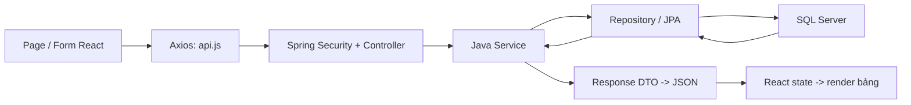
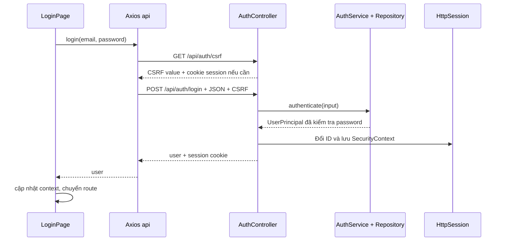

# Assignment 02 - Giải thích toàn bộ project theo luồng và từng file

**Project:** A2LuanLH_SE1910. **Sinh viên:** LuanLH / CE191099. **Bản source đối chiếu:** 30/10/2026.

Bản hiện tại dùng Spring Boot + SQL Server, đăng nhập session, entity Lombok và React chia thư mục theo trách nhiệm như A1. Trang đầu là Login hoặc màn quản lý theo role; tin Active cho khách được trình bày bằng bảng đơn giản ở `/news`.

Cách đọc: chọn một luồng trong mục lục, mở file được liên kết, thao tác trên trình duyệt rồi đối chiếu request, code và dữ liệu. Các đoạn code được trích từ source hiện tại; ID/email tình huống là ví dụ học tập. Liên kết source dùng đường dẫn trong repo; hậu tố #L đánh dấu dòng tương ứng trên GitHub.

## Mục lục

1. [Từ Assignment 1 sang Assignment 2: phần nào giữ, phần nào đổi?](#a1-a2)
2. [Bài toán, màn hình và quyền truy cập](#requirements)
3. [Cấu trúc thư mục và trách nhiệm từng phần](#folders)
4. [Các khái niệm Java, Spring và React cần biết trước](#vocabulary)
5. [Entity, Lombok và quan hệ giữa các bảng](#entities)
6. [DTO: dữ liệu nhận/trả của API và Java record](#dtos)
7. [Khởi động backend: Maven, cấu hình, beans và seed data](#backend-start)
8. [Khởi động frontend, AppLayout và các route](#frontend-start)
9. [Đăng nhập: từ form React đến session ở backend](#login)
10. [Phân quyền, cookie, CSRF và CORS](#security)
11. [Account: lấy tất cả, tìm kiếm, xem một bản ghi](#account-read)
12. [CrudPage và FormFields: đọc một lần để hiểu cả ba màn quản lý](#shared-ui)
13. [Account: luồng Create và Update từ popup tới SQL Server](#account-write)
14. [Account: Delete, khóa ngoại và clearUpdatedBy giải thích từng bước](#account-delete)
15. [Category: danh sách, tìm kiếm, tạo/sửa và quan hệ cha/con](#category)
16. [News và tags: từ textarea đến Entity/NewsTag](#news)
17. [Đọc tin công khai: bảng đơn giản và popup nội dung](#public-news)
18. [Lịch sử tin của chính Staff](#history)
19. [Sửa hồ sơ: vì sao user chỉ sửa được chính mình?](#profile)
20. [F5, hết phiên và Sign out](#session-life)
21. [Transaction, flush, dirty checking và đường đi khi có lỗi](#transaction-error)
22. [Những cú pháp dễ nhầm và cơ chế cập nhật React](#syntax-hooks)
23. [Bảng ánh xạ toàn bộ API để lần theo code](#api-map)
24. [Chạy project, format, Postman và đối chiếu database](#run-test)
25. [Tra cứu từng file: mở đúng chỗ khi cần giải thích](#file-index)
26. [Cách tự tái lập luồng và ôn interview](#practice)

<a id="a1-a2"></a>

## 1. Từ Assignment 1 sang Assignment 2: phần nào giữ, phần nào đổi?

Tài liệu này giải thích bản A2 hiện tại trong project `A2LuanLH_SE1910`: đăng nhập session, entity dùng Lombok, DTO tách riêng, frontend chia thư mục theo trách nhiệm như A1. Đọc kèm source; các khối code trích từ file đang có trong project.

A1 đã có form, bảng, popup, tìm kiếm và điều hướng. A2 tiếp tục các thao tác đó nhưng đưa nơi lưu dữ liệu và kiểm tra nghiệp vụ sang Spring Boot/SQL Server. Khi anh bấm Save, frontend phải đợi backend xác nhận thay vì chỉ cập nhật một mảng trong trình duyệt.

| Phần đã học ở A1                                | Cách tổ chức hiện tại trong A2                   | Điều anh cần hiểu thêm                                    |
| ----------------------------------------------- | ------------------------------------------------ | --------------------------------------------------------- |
| App khai báo Routes                             | App vẫn khai báo Routes và bọc AuthProvider      | Phục hồi phiên từ backend trước khi chọn màn hình         |
| components/Layout: Header, AdminLayout, Sidebar | components/Layout: Header và AppLayout có Outlet | A2 dùng menu trên Header; file Layout chỉ lo khung chung  |
| pages/UserManagement                            | pages/AccountManagement                          | Account của A2 dùng name/email/role, đăng nhập bằng email |
| pages/CategoryManagement, NewsManagement        | Giữ các trang quản lý cùng tên trong pages       | Thao tác gọi API, nhận lỗi 400/403/409 từ server          |
| services/dataService đọc/ghi localStorage       | services/api dùng Axios gọi Spring REST API      | Dữ liệu chính nằm trong SQL Server                        |
| App lưu trạng thái đăng nhập giả lập            | context/AuthContext giữ user cho giao diện       | Session và quyền được kiểm tra ở backend                  |
| map/filter và setter cập nhật bảng              | Hook đọc response rồi cập nhật state             | Đổi state không tự ghi database; cần request thành công   |

Tên file source có tiền tố `LuanLHCE191099_`; trong phần giải thích có thể viết ngắn `AccountService`, `Header`, `AccountManagement` cho dễ theo dõi. Tên đầy đủ nằm trong đường dẫn có thể bấm mở.

Trang `/` chuyển đến Login khi chưa đăng nhập, Accounts khi là Admin, hoặc News management khi là Staff. `/news` chỉ là bảng đọc tin Active cho khách; không có phần giới thiệu quảng bá, trang Dashboard hay Settings bổ sung.

<a id="requirements"></a>

## 2. Bài toán, màn hình và quyền truy cập

| Người dùng | Được thực hiện                    | Màn hình chính     |
| ---------- | --------------------------------- | ------------------ |
| Khách      | Xem tin Active và mở nội dung bài | /news              |
| Admin      | Thêm, xem, sửa, xóa, tìm Account  | /manage/accounts   |
| Staff      | CRUD/Search Category              | /manage/categories |
| Staff      | CRUD/Search News và tags          | /manage/news       |
| Staff      | Xem tin do chính mình tạo         | /history           |
| Staff      | Xem/sửa hồ sơ của chính mình      | /profile           |

Create và Edit dùng popup; Delete có xác nhận. Account đã tạo News không được xóa; Category đang có News không được xóa. Ngoài ra code kiểm tra Category con/chu trình và bảo vệ Admin cuối cùng để giữ dữ liệu, quyền quản lý nhất quán.

Admin không tự động có quyền Staff: hiện controller dùng `hasRole('ADMIN')` và `hasRole('STAFF')` riêng. Hai role đều đọc được tin công khai. Nếu sau này muốn một thao tác cho cả hai thì biểu thức tương ứng là `hasAnyRole('ADMIN', 'STAFF')`, nhưng đó là thay đổi quyền so với code hiện tại.

| Vị trí                                        | Ví dụ role                 | Vì sao khác nhau                                |
| --------------------------------------------- | -------------------------- | ----------------------------------------------- |
| SystemAccount và AccountInput/AccountResponse | 1 = Admin, 2 = Staff       | Giá trị số dùng trong dữ liệu quản lý account   |
| UserPrincipal trong session và React context  | ADMIN hoặc STAFF           | Tên quyền dùng để chọn menu và kiểm tra hasRole |
| Spring Security authorities                   | ROLE_ADMIN hoặc ROLE_STAFF | saveAuthentication thêm tiền tố ROLE_           |

<a id="folders"></a>

## 3. Cấu trúc thư mục và trách nhiệm từng phần

```text
A2LuanLH_SE1910/
├── backend/
│   ├── pom.xml
│   ├── application-local.properties.example
│   └── src/
│       ├── main/
│       │   ├── java/fu/edu/sba301/a2/
│       │   │   ├── LuanLHCE191099_Application.java
│       │   │   ├── config/
│       │   │   ├── controller/
│       │   │   ├── dto/
│       │   │   ├── entity/
│       │   │   ├── repository/
│       │   │   ├── security/
│       │   │   ├── service/
│       │   │   └── exception/
│       │   └── resources/application.properties
│       └── test/
├── frontend/
│   ├── package.json
│   ├── index.html
│   ├── vite.config.js
│   └── src/
│       ├── LuanLHCE191099_main.jsx
│       ├── LuanLHCE191099_App.jsx
│       ├── LuanLHCE191099_styles.css
│       ├── pages/
│       ├── components/
│       │   ├── Layout/
│       │   ├── Common/
│       │   └── LuanLHCE191099_ProtectedRoute.jsx
│       ├── context/
│       ├── hooks/
│       └── services/
├── database/
├── postman/
├── docs/
└── HUONG_DAN_ASSIGNMENT02_CHI_TIET.md
```

| Phần                | Trách nhiệm                                                           | Không nên nhầm với                          |
| ------------------- | --------------------------------------------------------------------- | ------------------------------------------- |
| Frontend pages      | Một màn hình cụ thể: Account, Category, News, Login, Profile, History | Không trực tiếp mở kết nối SQL Server       |
| components/Layout   | Header/menu và Outlet để ghép trang                                   | Không chứa nghiệp vụ xóa account            |
| components/Common   | Form và bảng CRUD dùng chung                                          | Không quyết định quyền thực sự của server   |
| context/AuthContext | Chia sẻ user/loading/login/logout cho các component                   | Không phải nơi lưu session ở server         |
| hooks/useApiList    | Quản lý vòng đời request đọc danh sách                                | Không tự tạo bảng database                  |
| services/api        | Axios client, cookie, CSRF, đọc message lỗi                           | Không phải Java Service                     |
| Java Controller     | Nhận HTTP, đọc URL/body/principal, gọi Service                        | Không viết toàn bộ nghiệp vụ vào controller |
| Java Service        | Validation nghiệp vụ, transaction, Entity -&gt; DTO                   | Không dựng JSX hoặc bảng HTML               |
| Repository          | Truy vấn/persist dữ liệu                                              | Không phải một trang React                  |
| Entity / DTO        | Entity ánh xạ bảng; DTO nhận/trả dữ liệu API                          | Không phải hai tên gọi cho cùng một object  |



<a id="vocabulary"></a>

## 4. Các khái niệm Java, Spring và React cần biết trước

| Từ/cú pháp                  | Ý nghĩa trong bài                                           | Ví dụ                                                                            |
| --------------------------- | ----------------------------------------------------------- | -------------------------------------------------------------------------------- |
| class / object              | Class mô tả kiểu; new tạo một object                        | new LuanLHCE191099_Account() tạo một account trong bộ nhớ                        |
| interface                   | Hợp đồng phương thức                                        | AccountRepository kế thừa JpaRepository                                          |
| public / private            | Phạm vi truy cập                                            | Controller gọi phương thức public của service; helper private chỉ dùng bên trong |
| final trên field            | Tham chiếu chỉ được gán một lần                             | Repository được gán trong constructor, không đổi sang repository khác            |
| constructor                 | Hàm khởi tạo object, cùng tên class và không có kiểu trả về | Spring truyền AccountRepository vào AccountService                               |
| List&lt;T&gt;               | Danh sách phần tử kiểu T                                    | List&lt;AccountResponse&gt; là danh sách DTO trả về                              |
| Optional&lt;T&gt;           | Một kết quả có thể có hoặc không                            | findById có thể không tìm thấy account                                           |
| record                      | Kiểu dữ liệu có constructor/accessor sinh sẵn               | input.email() đọc email của DTO                                                  |
| annotation @...             | Thông tin để framework/compiler xử lý                       | @RestController, @Valid, @Getter                                                 |
| Bean / dependency injection | Object do Spring quản lý, được cấp cho object khác          | Controller nhận Service qua constructor                                          |
| state                       | Dữ liệu React dùng khi render                               | formData, records, user, isBusy                                                  |
| props                       | Dữ liệu/callback cha truyền cho con                         | AccountManagement truyền fields và endpoint vào CrudPage                         |
| HTTP request/response       | Gói giao tiếp frontend với backend                          | POST /api/accounts và JSON account tạo thành công                                |

Spring tạo Controller/Service/Repository khi khởi động, nhưng phương thức xử lý request chỉ chạy khi có HTTP request tương ứng. React khai báo handler khi render, nhưng `handleSave()` chỉ chạy khi có submit. Không có quy luật "đọc xong file này là mọi hàm trong file đều chạy".

Hai chương trình chạy độc lập: Vite phục vụ frontend; Spring Boot phục vụ API. Thứ tự kết nối giữa chúng được quyết định bởi các request phát sinh từ thao tác người dùng hoặc useEffect.

<a id="entities"></a>

## 5. Entity, Lombok và quan hệ giữa các bảng

Mở [LuanLHCE191099_Account.java](backend/src/main/java/fu/edu/sba301/a2/entity/LuanLHCE191099_Account.java#L1).

```java
package fu.edu.sba301.a2.entity;

import jakarta.persistence.Column;
import jakarta.persistence.Entity;
import jakarta.persistence.GeneratedValue;
import jakarta.persistence.GenerationType;
import jakarta.persistence.Id;
import jakarta.persistence.Table;
import lombok.Getter;
import lombok.NoArgsConstructor;
import lombok.Setter;
import org.hibernate.annotations.Nationalized;

// JPA mapping for the SQL Server SystemAccount table; this class represents persisted data.
// @Column names preserve the assignment schema, and @Nationalized maps text fields to Unicode SQL types.
// Lombok generates accessors and the empty constructor required by JPA.
@Getter
@Setter
@NoArgsConstructor
@Entity
@Table(name = "SystemAccount")
public class LuanLHCE191099_Account {

    // Primary key generated by SQL Server IDENTITY; a new unsaved entity starts with a null ID.
    @Id
    @GeneratedValue(strategy = GenerationType.IDENTITY)
    @Column(name = "AccountID")
    private Long id;

    @Nationalized
    @Column(name = "AccountName", nullable = false, length = 100)
    private String name;

    // The database UNIQUE constraint is a final safeguard in addition to the service duplicate-email check.
    @Column(name = "AccountEmail", nullable = false, unique = true, length = 150)
    private String email;

    // Database role codes: 1 = Admin, 2 = Staff. AuthService maps these to authority names.
    @Column(name = "AccountRole", nullable = false)
    private Integer role;

    // Contains the BCrypt hash, not the plaintext password submitted at login.
    @Column(name = "AccountPassword", nullable = false, length = 100)
    private String password;
}
```

| Dòng/annotation                  | Diễn giải                                                                        |
| -------------------------------- | -------------------------------------------------------------------------------- |
| @Getter, @Setter                 | Lombok sinh getId/getName/getEmail/getRole/getPassword và các setter khi compile |
| @NoArgsConstructor               | Sinh constructor rỗng public để JPA có thể tạo entity                            |
| @Entity                          | Đăng ký class là entity được JPA quản lý                                         |
| @Table(name = "SystemAccount")   | Tên bảng SQL thực tế là SystemAccount                                            |
| @Id và @GeneratedValue(IDENTITY) | id là khóa chính do SQL Server tự sinh                                           |
| @Column(name = "AccountName")    | Thuộc tính name của Java ánh xạ đến cột AccountName                              |
| @Nationalized                    | Dùng kiểu Unicode cho text trong SQL Server, phù hợp tên/nội dung tiếng Việt     |
| unique = true                    | Email không được trùng ở database                                                |
| private String password          | Lưu BCrypt hash, không phải mật khẩu gõ trên form                                |

Sau khi thêm Lombok, `account.getName()` và `account.setName(...)` vẫn gọi được mặc dù anh không nhìn thấy phương thức viết tay trong file. Maven compiler chạy annotation processor để sinh chúng. Class Account vẫn là entity bình thường, và DTO vẫn do service tạo rõ ràng.

Category có `parent` trỏ đến một Category khác. NewsArticle có `category`, `createdBy`, `updatedBy`. Tag chứa id/name/note. Những quan hệ này dùng object ở Java và khóa ngoại ở SQL Server.

| Thuộc tính Java       | Cột/bảng liên quan                 | Ý nghĩa                                                     |
| --------------------- | ---------------------------------- | ----------------------------------------------------------- |
| Category.parent       | Category.ParentCategoryID          | null là Category gốc; nhiều Category con có thể cùng parent |
| NewsArticle.category  | NewsArticle.CategoryID             | Mỗi bài thuộc một Category                                  |
| NewsArticle.createdBy | NewsArticle.CreatedByID            | Account tạo bài; bắt buộc có                                |
| NewsArticle.updatedBy | NewsArticle.UpdatedByID            | Account sửa gần nhất; có thể null                           |
| NewsArticle.tags      | NewsTag nối NewsArticleID và TagID | Bài sở hữu nhiều Tag; TagID unique trong bảng nối           |

```text
Account 2 tạo nhiều NewsArticle
Category 1 chứa nhiều NewsArticle
NewsArticle 10 sở hữu Tag 7, Tag 8
Category con có thể trỏ đến một Category cha
```

`@ManyToOne` có nghĩa nhiều bản ghi bên này có thể cùng trỏ đến một object bên kia. `@JoinColumn` cho biết khóa ngoại nằm ở cột nào. Ví dụ `article.getCategory().getId()` là ID object Category; cột tương ứng trong database là CategoryID.

`FetchType.LAZY` cho phép Hibernate trì hoãn đọc entity liên quan và dùng proxy. Service cần đọc qua getter trong transaction khi tạo DTO. Với `spring.jpa.open-in-view=false`, không nên chờ đến lúc serialize JSON mới truy cập các quan hệ LAZY.

NewsArticle dùng `@OneToMany(cascade = CascadeType.ALL, orphanRemoval = true)` cho tags: save/delete bài kéo theo các thao tác persistence của tags; tag bị bỏ khỏi collection sẽ được xóa. Bảng nối NewsTag không cần Java entity riêng vì hiện chỉ lưu hai khóa ngoại.

<a id="dtos"></a>

## 6. DTO: dữ liệu nhận/trả của API và Java record

Mở [LuanLHCE191099_AccountInput.java](backend/src/main/java/fu/edu/sba301/a2/dto/LuanLHCE191099_AccountInput.java#L1).

```java
/** Request used by Admin to create or update an account. */
public record LuanLHCE191099_AccountInput(
    @NotBlank @Size(max = 100) String name,
    @NotBlank @Email @Size(max = 150) String email,
    @Size(max = 100) String password,
    @NotNull @Min(1) @Max(2) Integer role
) {}
```

Mở [LuanLHCE191099_AccountResponse.java](backend/src/main/java/fu/edu/sba301/a2/dto/LuanLHCE191099_AccountResponse.java#L1).

```java
/** Safe account details returned to the frontend; no password is included. */
public record LuanLHCE191099_AccountResponse(Long id, String name, String email, Integer role) {}
```

AccountInput là hợp đồng JSON cho Create/Update. AccountResponse là hợp đồng JSON trả về. Hai kiểu tách biệt giúp password có thể được nhận khi tạo tài khoản nhưng không xuất trong danh sách hoặc chi tiết tài khoản.

Với record, `input.email()` và `input.name()` là accessor. Nó không dùng `getEmail()` như entity. Các thành phần record không có setter; tham chiếu thành phần không gán lại sau khởi tạo. Điều này không tự biến mọi List nằm bên trong thành danh sách bất biến.

| DTO / mở file                                                                                          | Chiều        | Trường dữ liệu                                                                                                                                     | Mục đích                                          |
| ------------------------------------------------------------------------------------------------------ | ------------ | -------------------------------------------------------------------------------------------------------------------------------------------------- | ------------------------------------------------- |
| [AccountInput](backend/src/main/java/fu/edu/sba301/a2/dto/LuanLHCE191099_AccountInput.java#L1)         | Request      | name, email, password, role                                                                                                                        | Admin tạo/sửa account                             |
| [AccountResponse](backend/src/main/java/fu/edu/sba301/a2/dto/LuanLHCE191099_AccountResponse.java#L1)   | Response     | id, name, email, role                                                                                                                              | Thông tin account an toàn                         |
| [AuthResponse](backend/src/main/java/fu/edu/sba301/a2/dto/LuanLHCE191099_AuthResponse.java#L1)         | Response     | user                                                                                                                                               | Kết quả login chỉ có user                         |
| [CategoryInput](backend/src/main/java/fu/edu/sba301/a2/dto/LuanLHCE191099_CategoryInput.java#L1)       | Request      | name, description, parentId, status                                                                                                                | Tạo/sửa Category                                  |
| [CategoryResponse](backend/src/main/java/fu/edu/sba301/a2/dto/LuanLHCE191099_CategoryResponse.java#L1) | Response     | id, name, description, parentId, parentName, status                                                                                                | Category và thông tin parent dạng phẳng           |
| [LoginInput](backend/src/main/java/fu/edu/sba301/a2/dto/LuanLHCE191099_LoginInput.java#L1)             | Request      | email, password                                                                                                                                    | Email/password đăng nhập                          |
| [NewsInput](backend/src/main/java/fu/edu/sba301/a2/dto/LuanLHCE191099_NewsInput.java#L1)               | Request      | title, headline, content, source, categoryId, status, tags                                                                                         | Nội dung News và tags; không có tác giả tùy chọn  |
| [NewsResponse](backend/src/main/java/fu/edu/sba301/a2/dto/LuanLHCE191099_NewsResponse.java#L1)         | Response     | id, title, headline, content, source, categoryId, categoryName, status, createdById, createdByName, updatedByName, createdDate, modifiedDate, tags | News có tên Category/tác giả, thời gian và tags   |
| [ProfileInput](backend/src/main/java/fu/edu/sba301/a2/dto/LuanLHCE191099_ProfileInput.java#L1)         | Request      | name, email, password                                                                                                                              | Tên/email/password của chính Staff; không có role |
| [TagInput](backend/src/main/java/fu/edu/sba301/a2/dto/LuanLHCE191099_TagInput.java#L1)                 | Request con  | name, note                                                                                                                                         | Một tag trong NewsInput                           |
| [TagResponse](backend/src/main/java/fu/edu/sba301/a2/dto/LuanLHCE191099_TagResponse.java#L1)           | Response con | id, name, note                                                                                                                                     | Tag có ID đã lưu                                  |

`@NotBlank` chặn null/rỗng/toàn khoảng trắng; `@NotNull` chỉ yêu cầu có giá trị; `@Email` kiểm tra định dạng; `@Size` giới hạn độ dài; `@Min/@Max` giới hạn số; `@Positive` yêu cầu số dương khi có giá trị. `@Valid` trong controller kích hoạt kiểm tra DTO. `List<@Valid TagInput>` còn kiểm tra từng Tag bên trong NewsInput.

Không phải mọi nghiệp vụ đều diễn đạt bằng annotation: email trùng, password khi tạo, Category đang dùng và Admin cuối cùng được kiểm tra trong service. Cấu hình Jackson từ chối trường không có trong DTO; gửi thêm role vào ProfileInput sẽ nhận lỗi 400.

<a id="backend-start"></a>

## 7. Khởi động backend: Maven, cấu hình, beans và seed data

Mở [LuanLHCE191099_Application.java](backend/src/main/java/fu/edu/sba301/a2/LuanLHCE191099_Application.java#L1).

```java
package fu.edu.sba301.a2;

import org.springframework.boot.SpringApplication;
import org.springframework.boot.autoconfigure.SpringBootApplication;
import org.springframework.boot.autoconfigure.security.servlet.UserDetailsServiceAutoConfiguration;

// Backend entry point. Spring scans this package and its children for components and JPA mappings.
// Exclude the default generated-login setup because login uses the database accounts and a server session.
// Startup reads configuration, builds the application context/DataSource and then runs SeedData.
@SpringBootApplication(exclude = UserDetailsServiceAutoConfiguration.class)
public class LuanLHCE191099_Application {

    public static void main(String[] args) {
        SpringApplication.run(LuanLHCE191099_Application.class, args);
    }
}
```

`main()` là điểm vào JVM. `SpringApplication.run(...)` tạo ApplicationContext, đọc cấu hình, đăng ký beans, cấu hình DataSource/JPA và khởi động HTTP server. `@SpringBootApplication` quét package `fu.edu.sba301.a2` cùng các package con.

Project loại default UserDetailsServiceAutoConfiguration vì tự kiểm tra account trong AuthService và lưu phiên đăng nhập. Điều này không tắt Spring Security; SecurityFilterChain và @PreAuthorize vẫn hoạt động.

| Dependency trong pom.xml                           | Vai trò                                                                      |
| -------------------------------------------------- | ---------------------------------------------------------------------------- |
| spring-boot-starter-web                            | REST Controller, Jackson JSON, HTTP server nhúng                             |
| spring-boot-starter-data-jpa                       | Repository, JPA/Hibernate và tích hợp transaction                            |
| mssql-jdbc                                         | Driver Microsoft SQL Server                                                  |
| spring-boot-starter-security                       | SecurityContext, session authentication, CSRF và phân quyền                  |
| spring-boot-starter-validation                     | @Valid cùng các constraint của DTO                                           |
| lombok                                             | Sinh accessors/constructor khi compile; không cần runtime trong JAR đã build |
| spring-boot-starter-test, spring-security-test, H2 | Chạy test API với database bộ nhớ riêng                                      |

Mở [application.properties](backend/src/main/resources/application.properties#L1) để theo dõi cấu hình.

| Cấu hình                            | Tác dụng hiện tại                                                                    |
| ----------------------------------- | ------------------------------------------------------------------------------------ |
| server.port = 8082 mặc định         | Cổng backend; ${SERVER_PORT:8082} cho phép override                                  |
| spring.datasource.url               | JDBC SQL Server tại localhost:1433, database A2LuanLH_SE1910                         |
| spring.config.import                | Đọc file local tùy working directory root project hoặc backend                       |
| ddl-auto = update                   | Cập nhật bảng theo entity khi khởi động; database phải được tạo trước                |
| open-in-view = false                | Đọc quan hệ để tạo DTO trong service, không kéo persistence sang lúc render response |
| physical naming strategy            | Giữ tên bảng/cột được khai báo bằng annotation                                       |
| fail-on-unknown-properties = true   | JSON có trường ngoài DTO bị từ chối                                                  |
| A2SESSION / HttpOnly / SameSite Lax | Cấu hình cookie phiên; JavaScript không đọc được giá trị HttpOnly                    |
| session.timeout = 30m               | Phiên hết hạn sau 30 phút không hoạt động                                            |
| app.seed.enabled = true             | Cho phép thêm mẫu khi bảng account đang trống                                        |

File `backend/application-local.properties` chứa thông tin kết nối riêng và được Git bỏ qua. Không cần chép mật khẩu SQL thật vào tài liệu. Dùng file `.example` để biết vị trí điền trên máy khác.

SeedData implements ApplicationRunner nên chạy sau khi context khởi tạo. Nếu `accountRepository.count() > 0`, toàn bộ seed dừng ngay. Nếu bảng account trống thì tạo Admin/Staff với BCrypt hash, hai Category và hai bài: một Active, một Inactive. Nó không tự khôi phục từng bản ghi mẫu đã bị người dùng xóa.

Hai tài khoản mẫu: `admin@funews.local / Admin@123`, `staff@funews.local / Staff@123`. Chúng chỉ được seed lúc dữ liệu khởi tạo chưa có. ID trong các ví dụ sau là minh họa; khi thao tác phải dùng ID thực tế từ response/database.

<a id="frontend-start"></a>

## 8. Khởi động frontend, AppLayout và các route

Mở [LuanLHCE191099_main.jsx](frontend/src/LuanLHCE191099_main.jsx#L1).

```jsx
import React from 'react';
import ReactDOM from 'react-dom/client';
import 'bootstrap/dist/css/bootstrap.min.css';
import App from './LuanLHCE191099_App.jsx';

// Frontend entry point: index.html provides the DOM element whose id is "root".
// React mounts App there; App sets up routing, authentication context and pages.
// StrictMode enables extra development checks; it does not create two production screens.
ReactDOM.createRoot(document.getElementById('root')).render(
  <React.StrictMode>
    <App />
  </React.StrictMode>,
);
```

`index.html` có div `root` và script module trỏ đến main.jsx. createRoot tìm DOM element đó rồi render cây App. Import Bootstrap/CSS nạp style. StrictMode bật kiểm tra phát triển; một số effect có thể được thiết lập/dọn dẹp thêm ở chế độ dev, nên effect đọc API cần cleanup đúng.

App bọc BrowserRouter và AuthProvider. BrowserRouter quản lý URL; AuthProvider chia sẻ user/loading. AppLayout chứa Header và Outlet. Header lo menu/Sign out; Outlet nhận trang được route chọn, tương tự cách AdminLayout của A1 dùng Outlet.

Mở [LuanLHCE191099_App.jsx](frontend/src/LuanLHCE191099_App.jsx#L16), tìm `function HomeRedirect()`.

```jsx
function HomeRedirect() {
  const { user, loading } = useAuth();
  if (loading) {
    return <Spinner animation="border" role="status" />;
  }
  if (user?.role === 'ADMIN') {
    return <Navigate to="/manage/accounts" replace />;
  }
  if (user?.role === 'STAFF') {
    return <Navigate to="/manage/news" replace />;
  }
  return <Navigate to="/login" replace />;
}
```

| URL frontend       | Trang / ý nghĩa                                     | Quyền  |
| ------------------ | --------------------------------------------------- | ------ |
| /                  | HomeRedirect chọn Login hoặc màn quản lý theo phiên | Tất cả |
| /login             | LoginPage                                           | Tất cả |
| /news              | PublicNewsPage: bảng tin Active và popup đọc bài    | Tất cả |
| /manage/accounts   | AccountManagement                                   | Admin  |
| /manage/categories | CategoryManagement                                  | Staff  |
| /manage/news       | NewsManagement                                      | Staff  |
| /history           | HistoryPage                                         | Staff  |
| /profile           | ProfilePage                                         | Staff  |

ProtectedRoute chờ loading, kiểm tra đã có user chưa và role có trong danh sách cho phép không; thành công thì trả Outlet để hiển thị route con. Header ẩn menu không phù hợp để giao diện rõ ràng, còn backend mới là nơi kiểm tra quyền truy cập dữ liệu.

Đường dẫn frontend và API là hai việc khác nhau: `/manage/accounts` chọn màn hình React, còn `/api/accounts` nhận HTTP request để lấy/lưu account. Mở route React không có nghĩa controller đã chạy; request Axios mới kích hoạt controller.

<a id="login"></a>

## 9. Đăng nhập: từ form React đến session ở backend

Mở [LuanLHCE191099_LoginPage.jsx](frontend/src/pages/LuanLHCE191099_LoginPage.jsx#L21), tìm `async function handleLogin(`.

```jsx
async function handleLogin(event) {
  event.preventDefault();
  setError('');
  setIsSubmitting(true);

  try {
    const user = await auth.login(formData.email, formData.password);
    const destination = destinations[user.role] || '/';
    navigate(destination, { replace: true });
  } catch (error) {
    setError(errorText(error));
  } finally {
    setIsSubmitting(false);
  }
}
```

| Dòng/lời gọi                                        | Đang làm gì                                              |
| --------------------------------------------------- | -------------------------------------------------------- |
| event.preventDefault()                              | Ngăn submit mặc định làm trình duyệt tải lại cả trang    |
| setError('')                                        | Xóa lỗi của lần thử trước                                |
| setIsSubmitting(true)                               | Đánh dấu đang gửi và disable nút Sign in                 |
| await auth.login(formData.email, formData.password) | Đợi lời gọi HTTP trong AuthProvider hoàn tất             |
| destinations[user.role]                             | ADMIN tới /manage/accounts; STAFF tới /manage/news       |
| navigate(..., { replace: true })                    | Chuyển route trong SPA và thay entry Login trong history |
| catch / finally                                     | Hiển thị lỗi API và luôn mở lại nút khi request kết thúc |

Mở [LuanLHCE191099_AuthContext.jsx](frontend/src/context/LuanLHCE191099_AuthContext.jsx#L45), tìm `async function login(`.

```jsx
async function login(email, password) {
  const response = await api.post('/auth/login', { email, password });
  const loginResult = response.data;

  // The response sets an HttpOnly cookie; state updates the current screen.
  setUser(loginResult.user);
  return loginResult.user;
}
```

`response` là object do Axios trả về; `response.data` mới là JSON body của API. Backend trả `{ "user": { "id": ..., "email": ..., "name": ..., "role": "STAFF" } }`. setUser thay đổi state dùng cho Header và ProtectedRoute. Thông tin đăng nhập được server giữ trong session; trình duyệt tự nhận cookie HttpOnly.

Trước khi POST login thật sự được gửi, interceptor của api.js tự thực hiện GET `/auth/csrf`. Đọc chi tiết cơ chế đó ở phần tiếp theo; trong LoginPage anh chỉ cần lần theo `auth.login(...)`.

Mở [LuanLHCE191099_AuthController.java](backend/src/main/java/fu/edu/sba301/a2/controller/LuanLHCE191099_AuthController.java#L50), tìm `public LuanLHCE191099_AuthResponse login(`.

```java
public LuanLHCE191099_AuthResponse login(
    @Valid @RequestBody LuanLHCE191099_LoginInput input,
    HttpServletRequest request,
    HttpServletResponse response
) {
    LuanLHCE191099_UserPrincipal user = authService.authenticate(input);

    // Create a session if needed and rotate its ID after successful authentication.
    request.getSession(true);
    request.changeSessionId();
    saveAuthentication(user, request, response);
    csrfTokenRepository.saveToken(null, request, response);

    return new LuanLHCE191099_AuthResponse(user);
}
```

| Thành phần                                     | Ý nghĩa                                                              |
| ---------------------------------------------- | -------------------------------------------------------------------- |
| @PostMapping("/login") trên class có /api/auth | Nhận POST /api/auth/login                                            |
| @RequestBody LoginInput input                  | Jackson đọc JSON email/password thành record                         |
| @Valid                                         | Chạy các constraint trên LoginInput trước logic trong method         |
| HttpServletRequest / HttpServletResponse       | Spring cấp request/response hiện tại để làm việc với phiên và cookie |
| authService.authenticate(input)                | Kiểm tra account/password, trả danh tính an toàn                     |
| request.getSession(true)                       | Lấy session hiện tại hoặc tạo session nếu chưa có                    |
| request.changeSessionId()                      | Đổi mã phiên sau khi xác thực thành công                             |
| saveAuthentication(...)                        | Đưa danh tính/quyền vào SecurityContext và lưu vào session           |
| csrfTokenRepository.saveToken(null, ...)       | Bỏ giá trị CSRF cũ sau login; request ghi sau sẽ lấy giá trị mới     |
| new AuthResponse(user)                         | Trả thông tin user cho React, không trả password/hash                |

Mở [LuanLHCE191099_AuthService.java](backend/src/main/java/fu/edu/sba301/a2/service/LuanLHCE191099_AuthService.java#L28), tìm `public LuanLHCE191099_UserPrincipal authenticate(`.

```java
public LuanLHCE191099_UserPrincipal authenticate(LuanLHCE191099_LoginInput input) {
    LuanLHCE191099_Account account = accountRepository
        .findByEmailIgnoreCase(input.email().trim())
        .orElseThrow(() ->
            new LuanLHCE191099_ApiException(401, "Email or password is incorrect.")
        );

    boolean correctPassword = passwordEncoder.matches(input.password(), account.getPassword());
    if (!correctPassword) {
        throw new LuanLHCE191099_ApiException(401, "Email or password is incorrect.");
    }
    return toPrincipal(account);
}
```

Đầu tiên `findByEmailIgnoreCase(input.email().trim())` tìm account theo email, bỏ khoảng trắng hai đầu và không phân biệt hoa/thường. Không tìm thấy thì orElseThrow tạo ApiException 401.

`passwordEncoder.matches(input.password(), account.getPassword())` so sánh password gõ với BCrypt hash đã lưu. Nó không giải mã hash thành password. Hai lỗi email không tồn tại và password sai cùng dùng message "Email or password is incorrect.".

`toPrincipal(account)` chọn id/email/name/role, chuyển role số 1 thành ADMIN, còn role Staff thành STAFF. UserPrincipal implements Serializable vì được giữ trong session, và không chứa password.

Mở [LuanLHCE191099_AuthController.java](backend/src/main/java/fu/edu/sba301/a2/controller/LuanLHCE191099_AuthController.java#L78), tìm `private void saveAuthentication(`.

```java
private void saveAuthentication(
    LuanLHCE191099_UserPrincipal user,
    HttpServletRequest request,
    HttpServletResponse response
) {
    SimpleGrantedAuthority authority = new SimpleGrantedAuthority("ROLE_" + user.role());
    UsernamePasswordAuthenticationToken authentication =
        new UsernamePasswordAuthenticationToken(user, null, List.of(authority));
    SecurityContext context = SecurityContextHolder.createEmptyContext();
    context.setAuthentication(authentication);
    SecurityContextHolder.setContext(context);
    securityContextRepository.saveContext(context, request, response);
}
```

Đọc lần lượt bảy việc trong helper:

1. Tạo quyền `ROLE_ADMIN` hoặc `ROLE_STAFF` từ user.role().
2. Tạo Authentication chứa principal là user, credentials là null và danh sách quyền.
3. Tạo SecurityContext mới.
4. Đặt Authentication vào context.
5. Đặt context vào SecurityContextHolder để phần xử lý request hiện tại biết người gọi.
6. Gọi repository.saveContext để lưu context vào HttpSession.
7. Server gửi/duy trì cookie A2SESSION để lần sau tìm lại đúng phiên.

`UsernamePasswordAuthenticationToken` ở đây là tên class Authentication có sẵn của Spring Security. Nó là một object Java biểu diễn kết quả xác thực, không phải chuỗi JWT gửi/lưu ở frontend. Backend A2 hiện không có JwtFilter/JwtService hoặc thư viện ký JWT.

Nếu chỉ set context cho request hiện tại mà không lưu vào SecurityContextRepository thì request kế tiếp có thể không phục hồi được trạng thái đăng nhập. Đó là lý do có cả setContext và saveContext.



<a id="security"></a>

## 10. Phân quyền, cookie, CSRF và CORS

Mở [LuanLHCE191099_SecurityConfig.java](backend/src/main/java/fu/edu/sba301/a2/config/LuanLHCE191099_SecurityConfig.java#L1) và [LuanLHCE191099_api.js](frontend/src/services/LuanLHCE191099_api.js#L1).

| Bean/cấu hình                            | Tác dụng                                                                       |
| ---------------------------------------- | ------------------------------------------------------------------------------ |
| PasswordEncoder = BCryptPasswordEncoder  | Dùng chung khi seed, tạo/sửa account và xác thực login                         |
| HttpSessionSecurityContextRepository     | Lưu và đọc SecurityContext trong session backend                               |
| HttpSessionCsrfTokenRepository           | Giữ thông tin CSRF trong session để kiểm tra request ghi                       |
| SessionCreationPolicy.IF_REQUIRED        | Cho phép tạo session khi cần                                                   |
| GET /api/public/** và GET /api/auth/csrf | Cho phép gọi không cần đăng nhập                                               |
| POST /api/auth/login                     | Cho phép gửi thông tin đăng nhập; CSRF vẫn được kiểm tra                       |
| anyRequest().authenticated()             | Các endpoint còn lại cần danh tính đã xác thực                                 |
| @EnableMethodSecurity                    | Bật xử lý @PreAuthorize trên controller                                        |
| authenticationEntryPoint                 | Gửi JSON 401 khi thiếu đăng nhập                                               |
| accessDeniedHandler                      | Gửi JSON 403 khi bị từ chối quyền hoặc request không vượt qua bảo vệ tương ứng |
| logoutUrl /api/auth/logout               | Spring xử lý logout ở filter chain, không cần controller logout riêng          |

Mở [LuanLHCE191099_ProtectedRoute.jsx](frontend/src/components/LuanLHCE191099_ProtectedRoute.jsx#L6), tìm `export default function ProtectedRoute(`.

```jsx
export default function ProtectedRoute({ roles }) {
  const { user, loading } = useAuth();

  if (loading) {
    return (
      <Spinner animation="border" role="status">
        <span className="visually-hidden">Loading session</span>
      </Spinner>
    );
  }
  if (!user) {
    return <Navigate to="/login" replace />;
  }
  if (!roles.includes(user.role)) {
    return <Alert variant="warning">You do not have permission to open this page.</Alert>;
  }
  return <Outlet />;
}
```

ProtectedRoute quyết định trang React có được hiện không. Backend vẫn phải kiểm tra độc lập vì người dùng có thể gọi API bằng Postman mà không qua menu React.

`@AuthenticationPrincipal` lấy principal đã có từ session vào tham số controller. `@PreAuthorize("hasRole('STAFF')")` kiểm tra authority ROLE_STAFF trước khi cho chạy phương thức. Annotation ở class áp dụng cho các phương thức của controller trong bản hiện tại.

```java
// Ví dụ minh họa cách đọc điều kiện, không thay đổi quyền đang có:
@PreAuthorize("hasRole('STAFF')")
// Một role cụ thể được phép.

@PreAuthorize("hasAnyRole('ADMIN', 'STAFF')")
// Chỉ cần có một trong hai role.
```

Cookie chứa mã phiên giúp server nhận ra request thuộc phiên nào. Cookie HttpOnly không được JavaScript đọc trực tiếp; trình duyệt tự gửi nó khi điều kiện cookie/origin phù hợp. React state user chỉ phục vụ hiển thị.

Vì cookie được gửi tự động, các request thay đổi dữ liệu có thêm kiểm tra CSRF. API client thực hiện đoạn sau trước khi gửi request ghi:

```js
api.interceptors.request.use(async (config) => {
  const method = (config.method || 'get').toLowerCase();
  const changesData = ['post', 'put', 'patch', 'delete'].includes(method);

  if (changesData) {
    const response = await api.get('/auth/csrf');
    config.headers[response.data.headerName] = response.data.token;
  }
  return config;
});
```

| Đoạn code                                | Giải thích                                                    |
| ---------------------------------------- | ------------------------------------------------------------- |
| config.method                            | HTTP method của request đang chuẩn bị gửi                     |
| changesData                              | true với POST, PUT, PATCH, DELETE; GET không đi vào nhánh này |
| await api.get("/auth/csrf")              | Xin headerName/token CSRF từ server trước request ghi         |
| config.headers[response.data.headerName] | Tên header được chọn từ response, hiện là X-CSRF-TOKEN        |
| return config                            | Cho Axios tiếp tục gửi request đã được bổ sung header         |

Lời gọi GET CSRF cũng qua interceptor, nhưng method là GET nên changesData=false; vì vậy không bị lặp vô hạn. Sau login/logout, client lấy CSRF mới cho lần ghi tiếp theo, thay vì giữ một giá trị cũ mãi.

`baseURL: '/api'` làm api.get('/accounts') thành GET /api/accounts. `timeout: 15000` là 15 giây. `withCredentials: true` cho Axios tham gia cơ chế cookie. Vite proxy gửi /api tới localhost:8082, nên frontend có thể dùng cùng origin khi phát triển.

CORS là quy tắc trình duyệt khi gọi khác origin; cấu hình hiện cho phép localhost/127.0.0.1 và credentials. CORS, CSRF, xác thực và phân quyền là các cơ chế khác nhau. Không thể dùng việc ẩn menu hoặc CORS để thay cho kiểm tra role của backend.

<a id="account-read"></a>

## 11. Account: lấy tất cả, tìm kiếm, xem một bản ghi

Mở [LuanLHCE191099_AccountController.java](backend/src/main/java/fu/edu/sba301/a2/controller/LuanLHCE191099_AccountController.java#L40), tìm `public List<LuanLHCE191099_AccountResponse> getAccounts(`.

```java
public List<LuanLHCE191099_AccountResponse> getAccounts(
    @RequestParam(defaultValue = "") String q
) {
    if (q.isBlank()) {
        return accountService.getAllAccounts();
    }
    return accountService.searchAccounts(q);
}
```

Class controller có `@RequestMapping("/api/accounts")`; method có @GetMapping nên nhận GET collection. @RequestParam(defaultValue="") nhận q trên URL. Không có q thì chuỗi rỗng; q chỉ chứa khoảng trắng đi vào nhánh lấy tất cả.

GET `/api/accounts` gọi getAllAccounts(). GET `/api/accounts?q=luan` gọi searchAccounts(q). Tên phương thức là lựa chọn tổ chức code; HTTP method/path mới quyết định frontend gọi tới đâu.

Mở [LuanLHCE191099_AccountService.java](backend/src/main/java/fu/edu/sba301/a2/service/LuanLHCE191099_AccountService.java#L40), tìm `public List<LuanLHCE191099_AccountResponse> getAllAccounts(`.

```java
public List<LuanLHCE191099_AccountResponse> getAllAccounts() {
    List<LuanLHCE191099_Account> accounts = accountRepository.findAll(Sort.by("id"));
    List<LuanLHCE191099_AccountResponse> responses = new ArrayList<>();

    for (LuanLHCE191099_Account account : accounts) {
        responses.add(toResponse(account));
    }

    return responses;
}
```

| Dòng                                                            | Diễn giải                                                                |
| --------------------------------------------------------------- | ------------------------------------------------------------------------ |
| accountRepository.findAll(Sort.by("id"))                        | Đọc toàn bộ Account, sắp xếp ID tăng dần                                 |
| List&lt;AccountResponse&gt; responses = new ArrayList&lt;&gt;() | Tạo danh sách rỗng chứa DTO kết quả                                      |
| for (Account account : accounts)                                | Duyệt lần lượt từng entity đã đọc                                        |
| responses.add(toResponse(account))                              | Chuyển entity sang DTO và thêm vào danh sách trả về                      |
| return responses                                                | Controller nhận danh sách DTO; Spring/Jackson serialize thành JSON array |

Mở [LuanLHCE191099_AccountService.java](backend/src/main/java/fu/edu/sba301/a2/service/LuanLHCE191099_AccountService.java#L52), tìm `public List<LuanLHCE191099_AccountResponse> searchAccounts(`.

```java
public List<LuanLHCE191099_AccountResponse> searchAccounts(String searchText) {
    String keyword = searchText.trim().toLowerCase(Locale.ROOT);
    List<LuanLHCE191099_Account> accounts = accountRepository.findAll(Sort.by("id"));
    List<LuanLHCE191099_AccountResponse> responses = new ArrayList<>();

    for (LuanLHCE191099_Account account : accounts) {
        String accountText = account.getName() + " " + account.getEmail();
        boolean matchesKeyword = accountText.toLowerCase(Locale.ROOT).contains(keyword);

        if (matchesKeyword) {
            responses.add(toResponse(account));
        }
    }

    return responses;
}
```

Ví dụ searchText là `"  LUAN  "`: trim() cho `"LUAN"`, toLowerCase(Locale.ROOT) cho `"luan"`. Locale.ROOT dùng quy tắc đổi chữ trung lập, không lấy ngôn ngữ mặc định của máy.

Mỗi account được ghép name + khoảng trắng + email, rồi đổi thành chữ thường. contains(keyword) trả boolean: true thì thêm DTO, false thì bỏ qua. Từ khóa rỗng được chứa trong mọi chuỗi, nên bản thân helper tìm kiếm cũng có thể trả toàn bộ khi keyword rỗng.

Hiện findAll đọc dữ liệu trước, vòng lặp lọc trong Java sau; đây chưa phải câu SELECT có WHERE theo từ khóa và chưa có phân trang. Không cần tưởng rằng mọi filter/if trong service đều được đổi thành SQL.

Mở [LuanLHCE191099_AccountService.java](backend/src/main/java/fu/edu/sba301/a2/service/LuanLHCE191099_AccountService.java#L185), tìm `private LuanLHCE191099_AccountResponse toResponse(`.

```java
private LuanLHCE191099_AccountResponse toResponse(LuanLHCE191099_Account account) {
    return new LuanLHCE191099_AccountResponse(
        account.getId(),
        account.getName(),
        account.getEmail(),
        account.getRole()
    );
}
```

toResponse lấy id/name/email/role và tạo record mới. Password/hash vẫn nằm trong entity/database, nhưng không nằm trong DTO nên không xuất ra JSON account.

getAccountById(id) dùng findAccountOrThrow(id). Repository.findById trả Optional; orElseThrow ném 404 khi không có bản ghi. `GET /api/accounts/{id}` tồn tại cho đọc chi tiết; khi bấm Edit, frontend hiện tại tận dụng dòng đã có trong danh sách để điền form, không bắt buộc phát thêm GET chi tiết.

<a id="shared-ui"></a>

## 12. CrudPage và FormFields: đọc một lần để hiểu cả ba màn quản lý

Mở [LuanLHCE191099_AccountManagement.jsx](frontend/src/pages/LuanLHCE191099_AccountManagement.jsx#L1).

```jsx
import CrudPage from '../components/Common/LuanLHCE191099_CrudPage.jsx';

// Account-specific form metadata used by CrudPage and FormFields.
// role is converted to a number before sending: Admin=1 and Staff=2. Password is never a table column.
const fields = [
  { name: 'name', label: 'Name', required: true, maxLength: 100 },
  { name: 'email', label: 'Email', type: 'email', required: true, maxLength: 150 },
  {
    name: 'password',
    label: 'Password',
    type: 'password',
    required: true,
    maxLength: 100,
    help: 'Leave blank when editing to keep the current password.',
  },
  {
    name: 'role',
    label: 'Role',
    type: 'select',
    numeric: true,
    required: true,
    options: [
      { value: 1, label: 'Admin' },
      { value: 2, label: 'Staff' },
    ],
  },
];
const columns = [
  { key: 'id', label: 'ID' },
  { key: 'name', label: 'Name' },
  { key: 'email', label: 'Email' },
  { key: 'role', label: 'Role', render: (value) => (value === 1 ? 'Admin' : 'Staff') },
];
// Compose the shared CRUD component for /api/accounts; new accounts default to Staff.
// Backend AccountController permits only ADMIN, and AccountService enforces deletion restrictions.
export default function AccountManagement() {
  return (
    <CrudPage
      title="Account management"
      endpoint="/accounts"
      fields={fields}
      columns={columns}
      defaults={{ role: 2 }}
      deleteHint="An account that has created news cannot be deleted."
    />
  );
}
```

AccountManagement cung cấp cấu hình trang. fields mô tả input, columns mô tả cột hiển thị, endpoint là resource API. CrudPage thực hiện phần thao tác chung. CategoryManagement/NewsManagement cũng dùng component đó với cấu hình khác.

fields không phải dữ liệu account trong database. Ví dụ `{ name: 'email', type: 'email', required: true }` chỉ nói rằng form cần ô email bắt buộc. Dữ liệu người dùng nhập nằm trong formData của CrudPage.

| State trong CrudPage | Giá trị/ý nghĩa                                           |
| -------------------- | --------------------------------------------------------- |
| search               | Từ khóa của ô Search; đổi nó sẽ đổi URL mà useApiList đọc |
| formData             | null: đóng editor; object: bản nháp đang mở trong editor  |
| editingId            | null: Create; có ID: Update bản ghi đó                    |
| recordToDelete       | null: đóng xác nhận; object: dòng đang chọn xóa           |
| isBusy               | Khóa thao tác lặp trong khi request đang chạy             |
| formError            | Lỗi validation/nghiệp vụ hiển thị trong popup             |
| successMessage       | Thông báo sau khi thao tác thành công                     |

Mở [LuanLHCE191099_CrudPage.jsx](frontend/src/components/Common/LuanLHCE191099_CrudPage.jsx#L45), tìm `function buildFormData(`.

```jsx
function buildFormData(record = null) {
  const values = {};
  for (const field of fields) {
    if (record !== null) {
      values[field.name] = record[field.name] ?? '';
    } else {
      values[field.name] = defaults[field.name] ?? '';
    }
  }

  if (record !== null && mapRecordToForm) {
    return mapRecordToForm(values, record);
  }
  return values;
}
```

Vòng lặp đi qua fields để lấy đúng các trường được phép chỉnh. Có record thì lấy từ record; không có thì lấy defaults. Toán tử ?? chỉ dùng fallback khi null/undefined; status=0 vẫn được giữ.

Nếu page có mapRecordToForm thì gọi helper để đổi dữ liệu về dạng dễ sửa. News dùng nó để đổi mảng tag DTO thành text nhiều dòng. Khi Create, editingId=null và buildFormData lấy defaults; khi Edit, editingId nhận record.id.

Mở [LuanLHCE191099_FormFields.jsx](frontend/src/components/Common/LuanLHCE191099_FormFields.jsx#L5), tìm `function updateField(`.

```jsx
function updateField(fieldName, newValue) {
  const updatedValues = { ...value };
  updatedValues[fieldName] = newValue;
  onChange(updatedValues);
}
```

Ví dụ fieldName="email", newValue="staff5@example.com". `{ ...value }` tạo shallow copy của object form hiện tại; `updatedValues[fieldName] = newValue` chỉ thay trường email. `onChange(updatedValues)` chính là setter mà cha truyền xuống, nên lần render kế tiếp input lấy value mới.

Trong JSX, value={value[field.name] ?? ''} đưa state vào input. onChange nhận event.target.value rồi gọi updateField. Cách nối hai chiều này là controlled input. Required/maxLength/type email giúp người dùng nhập; backend vẫn kiểm tra độc lập.

renderInput chọn Form.Select khi type=select, textarea khi type=textarea, còn lại là input. isRequired cho password thành không bắt buộc ở mode Edit để người dùng giữ mật khẩu cũ. Input password hiện có minLength=6 ở frontend; khi tạo account service cũng kiểm tra tối thiểu sáu ký tự.

Mở [LuanLHCE191099_CrudPage.jsx](frontend/src/components/Common/LuanLHCE191099_CrudPage.jsx#L80), tìm `function buildRequestBody(`.

```jsx
function buildRequestBody() {
  const values = { ...formData };
  for (const field of fields) {
    if (field.numeric) {
      values[field.name] = values[field.name] === '' ? null : Number(values[field.name]);
    }
  }
  return prepareRequest(values);
}
```

HTML input/select thường trả chuỗi, nên role="2" phải đổi thành số 2; status="0" thành số 0. Trường numeric rỗng đổi thành null. Sau đó prepareRequest(values) có thể đổi riêng cấu trúc của page, ví dụ tags của News.

Form chỉ chứa các field khai báo nên không gửi ngược cả response DTO với id/password hash/tên người tạo. Endpoint API có DTO riêng tiếp tục kiểm tra giới hạn các trường được phép nhận.

<a id="account-write"></a>

## 13. Account: luồng Create và Update từ popup tới SQL Server

Mở [LuanLHCE191099_CrudPage.jsx](frontend/src/components/Common/LuanLHCE191099_CrudPage.jsx#L97), tìm `async function handleSave(`.

```jsx
async function handleSave(event) {
  event.preventDefault();
  setIsBusy(true);
  setFormError('');

  try {
    const requestBody = buildRequestBody();
    if (editingId === null) {
      await api.post(endpoint, requestBody);
      setSuccessMessage('Record created.');
    } else {
      await api.put(`${endpoint}/${editingId}`, requestBody);
      setSuccessMessage('Changes saved.');
    }
    setFormData(null);
    reloadAfterChange();
  } catch (error) {
    setFormError(errorText(error));
  } finally {
    setIsBusy(false);
  }
}
```

handleSave được Form gọi khi submit. Bước chuẩn bị đặt isBusy và xóa lỗi cũ. Nếu editingId=null thì POST endpoint; nếu có ID thì PUT endpoint/id. await đợi response thành công rồi mới đóng form, thông báo và reload danh sách.

Nếu backend trả lỗi, control nhảy vào catch và đặt formError; popup còn mở để anh sửa. finally luôn đặt isBusy=false. Một callback onChanged có thể đọc lại dữ liệu phụ: CategoryManagement dùng nó để cập nhật danh sách Category cha sau CRUD.

```json
{
  "name": "Staff 5",
  "email": "staff5@example.com",
  "password": "Practice@123",
  "role": 2
}
```

JSON minh họa trên là body POST /api/accounts. Controller @Valid kiểm tra DTO trước khi gọi service. Role của người thực hiện phải là Admin; role trong body là role muốn cấp cho account mới, không phải cách chứng minh người gửi là Admin.

Mở [LuanLHCE191099_AccountService.java](backend/src/main/java/fu/edu/sba301/a2/service/LuanLHCE191099_AccountService.java#L75), tìm `public LuanLHCE191099_AccountResponse createAccount(`.

```java
public LuanLHCE191099_AccountResponse createAccount(LuanLHCE191099_AccountInput input) {
    LuanLHCE191099_Account account = new LuanLHCE191099_Account();
    applyInput(account, input);

    // Flush executes pending SQL; the transaction commits after this service call succeeds.
    LuanLHCE191099_Account savedAccount = accountRepository.saveAndFlush(account);
    return toResponse(savedAccount);
}
```

new Account() mới tạo object trong bộ nhớ, chưa có ID database. applyInput kiểm tra và gán dữ liệu. saveAndFlush persist thay đổi và đẩy SQL xuống database; SQL Server sinh ID. toResponse tạo object trả về, chỉ gồm thông tin an toàn.

Method được @Transactional. Commit được thực hiện khi lời gọi transactional service hoàn tất thành công, không phải cứ gọi flush là đã commit.

Mở [LuanLHCE191099_AccountService.java](backend/src/main/java/fu/edu/sba301/a2/service/LuanLHCE191099_AccountService.java#L144), tìm `private void applyInput(`.

```java
private void applyInput(LuanLHCE191099_Account account, LuanLHCE191099_AccountInput input) {
    String email = input.email().trim().toLowerCase(Locale.ROOT);
    Optional<LuanLHCE191099_Account> existingAccount = accountRepository.findByEmailIgnoreCase(
        email
    );

    if (existingAccount.isPresent()) {
        boolean belongsToAnotherAccount = !existingAccount
            .get()
            .getId()
            .equals(account.getId());
        if (belongsToAnotherAccount) {
            throw new LuanLHCE191099_ApiException(409, "Email already exists.");
        }
    }

    boolean hasNewPassword = input.password() != null && !input.password().isBlank();
    if (account.getId() == null && !hasNewPassword) {
        throw new LuanLHCE191099_ApiException(400, "Password is required.");
    }
    if (hasNewPassword) {
        if (input.password().length() < 6) {
            throw new LuanLHCE191099_ApiException(
                400,
                "Password must contain at least 6 characters."
            );
        }
        account.setPassword(passwordEncoder.encode(input.password()));
    }

    account.setName(input.name().trim());
    account.setEmail(email);
    account.setRole(input.role());
}
```

| Bước trong applyInput                           | Lý do                                            |
| ----------------------------------------------- | ------------------------------------------------ |
| Trim/lowercase email                            | Chuẩn hóa trước khi kiểm tra và lưu              |
| findByEmailIgnoreCase                           | Xem email đã được account khác dùng chưa         |
| existingAccount.isPresent()                     | Optional đang chứa một account thật              |
| So ID của account tìm thấy với account đang sửa | Sửa account có quyền giữ email của chính mình    |
| account.getId() == null và password không có    | Tạo mới phải cung cấp password                   |
| Password không rỗng nhưng ngắn hơn 6            | Từ chối input không đạt quy tắc tạo/đổi mật khẩu |
| passwordEncoder.encode                          | Hash password mới trước khi gán vào entity       |
| setName, setEmail, setRole                      | Đưa các giá trị đã xử lý vào entity              |

Nếu Optional không chứa gì, email chưa tồn tại. Khi Update, DTO vẫn có password nhưng người dùng có thể để rỗng: hasNewPassword=false nên code không gọi setPassword, giữ hash đang có. API response không điền sẵn password vào form.

updateAccount(id,input) tìm entity hiện có. Nếu account đang là Admin mà input đổi thành Staff và hệ thống chỉ còn một Admin thì trả 409. Nếu hợp lệ, applyInput và saveAndFlush chạy trong cùng transaction. Controller trả 200 cho Update, 201 cho Create.

<a id="account-delete"></a>

## 14. Account: Delete, khóa ngoại và clearUpdatedBy giải thích từng bước

Mở [LuanLHCE191099_CrudPage.jsx](frontend/src/components/Common/LuanLHCE191099_CrudPage.jsx#L120), tìm `function openDeleteModal(`.

```jsx
function openDeleteModal(record) {
  setRecordToDelete(record);
  setFormError('');
}
```

Mở [LuanLHCE191099_CrudPage.jsx](frontend/src/components/Common/LuanLHCE191099_CrudPage.jsx#L131), tìm `async function handleDelete(`.

```jsx
async function handleDelete() {
  setIsBusy(true);
  setFormError('');

  try {
    const response = await api.delete(`${endpoint}/${recordToDelete.id}`);
    setSuccessMessage(response.data?.message || 'Record deleted.');
    setRecordToDelete(null);
    reloadAfterChange();
  } catch (error) {
    // A 409 stays visible in the dialog when related data prevents deletion.
    setFormError(errorText(error));
  } finally {
    setIsBusy(false);
  }
}
```

Bấm Delete trên dòng chỉ gọi openDeleteModal(record), lưu object vào recordToDelete và mở xác nhận. Chỉ nút Delete cuối trong popup mới gọi handleDelete. Với endpoint=/accounts và recordToDelete.id=5, request là DELETE /api/accounts/5.

Controller lấy id từ URL, lấy user đang đăng nhập qua @AuthenticationPrincipal, rồi gọi accountService.deleteAccount(id,user.id()). Hai ID không cùng ý nghĩa: id là người bị xóa, user.id() là người đang thực hiện thao tác.

Mở [LuanLHCE191099_AccountService.java](backend/src/main/java/fu/edu/sba301/a2/service/LuanLHCE191099_AccountService.java#L102), tìm `public void deleteAccount(`.

```java
public void deleteAccount(Long accountId, Long currentUserId) {
    LuanLHCE191099_Account account = findAccountOrThrow(accountId);

    if (accountId.equals(currentUserId)) {
        throw new LuanLHCE191099_ApiException(409, "You cannot delete your current account.");
    }
    if (newsRepository.existsByCreatedBy_Id(accountId)) {
        throw new LuanLHCE191099_ApiException(
            409,
            "This account has created news articles and cannot be deleted."
        );
    }
    if (account.getRole() == 1 && accountRepository.countByRole(1) <= 1) {
        throw new LuanLHCE191099_ApiException(409, "At least one Admin account must remain.");
    }

    // Editor references are optional. Author references were protected by the check above.
    newsRepository.clearUpdatedBy(accountId);
    accountRepository.delete(account);
    accountRepository.flush();
}
```

| Điều kiện/bước                        | Kết quả hoặc lý do                                       |
| ------------------------------------- | -------------------------------------------------------- |
| findAccountOrThrow(accountId)         | Không có account thì 404, chưa làm thao tác ghi          |
| accountId.equals(currentUserId)       | Chặn tự xóa account đang đăng nhập bằng 409              |
| existsByCreatedBy_Id(accountId)       | Account đã tạo bất kỳ News thì không được xóa            |
| Role là Admin và countByRole(1)&lt;=1 | Chặn xóa Admin cuối cùng                                 |
| clearUpdatedBy(accountId)             | Bỏ các liên kết người sửa tùy chọn trước khi xóa account |
| accountRepository.delete(account)     | Đánh dấu entity để xóa                                   |
| accountRepository.flush()             | Đẩy thao tác SQL đang chờ xuống database                 |

Mở [LuanLHCE191099_NewsRepository.java](backend/src/main/java/fu/edu/sba301/a2/repository/LuanLHCE191099_NewsRepository.java#L23).

```java
@Modifying
@Query("update LuanLHCE191099_NewsArticle n set n.updatedBy = null where n.updatedBy.id = :id")
void clearUpdatedBy(@Param("id") Long id);
```

| Thành phần                 | Nghĩa chính xác                                            |
| -------------------------- | ---------------------------------------------------------- |
| @Query                     | Khai báo truy vấn thực thi cho method repository           |
| LuanLHCE191099_NewsArticle | Tên Entity trong Java; đây là JPQL                         |
| n                          | Bí danh đại diện cho NewsArticle trong truy vấn            |
| where n.updatedBy.id = :id | Chọn các bài có ID người sửa bằng tham số id               |
| set n.updatedBy = null     | Bỏ quan hệ đến người sửa đó; cột UpdatedByID được đặt null |
| @Param("id") Long id       | Bind tham số Java vào vị trí :id                           |
| @Modifying                 | Thông báo query này cập nhật dữ liệu, không phải SELECT    |
| void                       | Không cần nhận số dòng cập nhật hay dữ liệu trả về         |

Ví dụ account 5 chưa tạo bài nào nhưng đã sửa bài A và B do account 2 tạo. Đề chỉ chặn xóa người đã tạo bài. Tuy nhiên UpdatedByID của A/B vẫn là khóa ngoại trỏ đến account 5. Phải giải phóng liên kết tùy chọn này trước khi xóa account 5.

| Bản ghi | Trước clearUpdatedBy(5L) | Sau clearUpdatedBy(5L)      |
| ------- | ------------------------ | --------------------------- |
| Bài A   | createdBy=2, updatedBy=5 | createdBy=2, updatedBy=null |
| Bài B   | createdBy=2, updatedBy=5 | createdBy=2, updatedBy=null |
| Bài C   | createdBy=3, updatedBy=2 | Giữ nguyên                  |

Không xóa bài A/B, không đổi tác giả gốc, không xóa Category. Chỉ bỏ liên kết người sửa, rồi mới xóa account. Nếu account 5 đã tạo bài nào thì bước existsByCreatedBy_Id đã chặn trước, clearUpdatedBy không chạy.

@Modifying không tự mở transaction. Transaction ghi nằm trên AccountService.deleteAccount, bao cả clearUpdatedBy và delete. Nếu thao tác xóa thất bại và exception thoát khỏi service, các thay đổi trong transaction được rollback; không để database chỉ lưu nửa luồng.

Controller trả 204 No Content khi thành công. Axios nhận response rồi đóng xác nhận, gọi reloadAfterChange để GET lại danh sách. Nếu lỗi 409 thì formError hiện lý do và popup tiếp tục mở.

<a id="category"></a>

## 15. Category: danh sách, tìm kiếm, tạo/sửa và quan hệ cha/con

Mở [LuanLHCE191099_CategoryManagement.jsx](frontend/src/pages/LuanLHCE191099_CategoryManagement.jsx#L1) và [LuanLHCE191099_CategoryService.java](backend/src/main/java/fu/edu/sba301/a2/service/LuanLHCE191099_CategoryService.java#L1).

CategoryManagement dùng CrudPage với endpoint=/categories. Nó gọi thêm useApiList('/categories') để có dữ liệu dựng danh sách parent. Dropdown gửi parentId là số, còn nhãn hiển thị là category.name.

Có hai nguồn đọc cùng resource nhưng hai nhiệm vụ: danh sách trong CrudPage thay đổi theo Search; danh sách phía page cung cấp toàn bộ lựa chọn Category cha. onChanged={categories.reload} cập nhật lựa chọn sau khi thêm/sửa/xóa thành công.

CategoryController cũng tách GET collection theo q: getAllCategories khi rỗng, searchCategories khi có từ khóa. Search chỉ so tên Category. Create/Update dùng CategoryInput; response có parentId và parentName để bảng không cần tự gọi thêm API tìm tên cha.

Mở [LuanLHCE191099_CategoryService.java](backend/src/main/java/fu/edu/sba301/a2/service/LuanLHCE191099_CategoryService.java#L90), tìm `private void applyInput(`.

```java
private void applyInput(LuanLHCE191099_Category category, LuanLHCE191099_CategoryInput input) {
    LuanLHCE191099_Category parent = null;
    if (input.parentId() != null) {
        parent = findCategoryOrThrow(input.parentId());
    }

    // Walk upward from the chosen parent. Reaching this category would create a cycle.
    LuanLHCE191099_Category ancestor = parent;
    while (ancestor != null) {
        if (ancestor.getId().equals(category.getId())) {
            throw new LuanLHCE191099_ApiException(
                400,
                "A category cannot be its own ancestor."
            );
        }
        ancestor = ancestor.getParent();
    }

    category.setName(input.name().trim());
    category.setDescription(input.description());
    category.setStatus(input.status());
    category.setParent(parent);
}
```

| Bước                                       | Giải thích                                                         |
| ------------------------------------------ | ------------------------------------------------------------------ |
| parent = null                              | Ban đầu giả sử đây là Category gốc                                 |
| input.parentId() != null                   | Nếu form chọn cha thì phải đọc cha thật từ database                |
| ancestor = parent                          | Bắt đầu kiểm tra từ cha vừa chọn                                   |
| while (ancestor != null)                   | Đi lên từng cấp cha cho đến Category gốc                           |
| ancestor.getId().equals(category.getId())  | Gặp lại chính Category đang sửa nghĩa là sẽ tạo chu trình, trả 400 |
| ancestor = ancestor.getParent()            | Chuyển sang cấp cha cao hơn                                        |
| setName/setDescription/setStatus/setParent | Chỉ gán dữ liệu sau khi kiểm tra quan hệ hợp lệ                    |

Ví dụ B đang có parent=A. Nếu sửa A để parent=B thì chuỗi A -> B -> A bị vòng. Vòng while phát hiện A xuất hiện trong chuỗi cha được chọn và từ chối thay đổi. Đặt parentId=null thì Category trở thành gốc.

Đây là kiểm tra quan hệ, không phải lọc danh sách hiển thị. Không nên chỉ ẩn chính Category khỏi dropdown rồi cho rằng đã xử lý xong, vì request vẫn có thể gửi bằng Postman.

Mở [LuanLHCE191099_CategoryService.java](backend/src/main/java/fu/edu/sba301/a2/service/LuanLHCE191099_CategoryService.java#L75), tìm `public void deleteCategory(`.

```java
public void deleteCategory(Long categoryId) {
    LuanLHCE191099_Category category = findCategoryOrThrow(categoryId);
    if (newsRepository.existsByCategory_Id(categoryId)) {
        throw new LuanLHCE191099_ApiException(
            409,
            "This category is used by news articles and cannot be deleted."
        );
    }
    if (categoryRepository.existsByParent_Id(categoryId)) {
        throw new LuanLHCE191099_ApiException(409, "This category has child categories.");
    }
    categoryRepository.delete(category);
    categoryRepository.flush();
}
```

findCategoryOrThrow xác minh ID tồn tại. existsByCategory_Id kiểm tra bài viết đang sử dụng Category, không phân biệt bài Active/Inactive. existsByParent_Id kiểm tra Category còn có con hay không. Nếu một trong hai đang tham chiếu thì trả 409; vượt qua mới delete và flush.

Category.status là dữ liệu Active/Inactive của Category. Code hiện kiểm tra trạng thái bài viết khi phục vụ tin công khai; không tự thêm quy tắc rằng Category Inactive sẽ làm mọi bài của nó bị ẩn. Khi muốn hiểu một ràng buộc, phải tìm đúng điều kiện trong service thay vì suy đoán từ tên status.

<a id="news"></a>

## 16. News và tags: từ textarea đến Entity/NewsTag

Mở [LuanLHCE191099_NewsManagement.jsx](frontend/src/pages/LuanLHCE191099_NewsManagement.jsx#L1) và [LuanLHCE191099_NewsService.java](backend/src/main/java/fu/edu/sba301/a2/service/LuanLHCE191099_NewsService.java#L1).

NewsManagement truyền endpoint=/news, newsColumns, fields và hai helper chuyển đổi cho CrudPage. Dropdown Category lấy danh sách từ API rồi map thành {value: id, label: name}. Form gửi categoryId, không gửi toàn bộ object Category.

Tags được nhập một dòng cho mỗi tag. Ví dụ textarea:

```text
campus | University life
study | Learning resources
```

Mở [LuanLHCE191099_NewsManagement.jsx](frontend/src/pages/LuanLHCE191099_NewsManagement.jsx#L50), tìm `function prepareRequest(`.

```jsx
function prepareRequest(values) {
  const tags = [];
  const lines = values.tags.split('\n');
  for (const rawLine of lines) {
    const line = rawLine.trim();
    if (line === '') {
      continue;
    }

    const separator = line.indexOf('|');
    let name = line;
    let note = '';
    if (separator !== -1) {
      name = line.slice(0, separator).trim();
      note = line.slice(separator + 1).trim();
    }
    tags.push({ name, note });
  }

  return { ...values, tags };
}
```

| Đoạn                       | Dữ liệu thay đổi ra sao                                       |
| -------------------------- | ------------------------------------------------------------- |
| values.tags.split('\n')    | Một chuỗi textarea thành danh sách dòng                       |
| rawLine.trim()             | Bỏ khoảng trắng ngoài mỗi dòng                                |
| line === '' -&gt; continue | Bỏ dòng trống, chuyển sang dòng kế tiếp                       |
| line.indexOf('\|')         | Tìm dấu ngăn cách đầu tiên; -1 nghĩa là không có note         |
| slice(0, separator)        | Lấy phần name ở bên trái dấu ngăn cách                        |
| slice(separator + 1)       | Lấy phần note ở bên phải, giữ các dấu \| sau đó trong note    |
| tags.push({ name, note })  | Tạo một object TagInput cho dòng đó                           |
| return { ...values, tags } | Giữ các field khác và thay tags dạng text bằng tags dạng mảng |

```json
{
  "title": "Campus workshop",
  "headline": "A short introduction",
  "categoryId": 1,
  "content": "Full article content",
  "source": "University office",
  "status": 1,
  "tags": [
    { "name": "campus", "note": "University life" },
    { "name": "study", "note": "Learning resources" }
  ]
}
```

Đây là body minh họa POST /api/news. createdById không có trong input. NewsController lấy user từ session rồi truyền user.id() vào service. Vì vậy tác giả được xác định ở server.

Mở [LuanLHCE191099_NewsService.java](backend/src/main/java/fu/edu/sba301/a2/service/LuanLHCE191099_NewsService.java#L99), tìm `public LuanLHCE191099_NewsResponse createNews(`.

```java
public LuanLHCE191099_NewsResponse createNews(
    LuanLHCE191099_NewsInput input,
    Long currentUserId
) {
    LuanLHCE191099_NewsArticle article = new LuanLHCE191099_NewsArticle();
    article.setCreatedBy(findAuthorOrThrow(currentUserId));
    article.setCreatedDate(LocalDateTime.now());
    applyInput(article, input);
    return toResponse(newsRepository.saveAndFlush(article));
}
```

Tạo entity mới, tìm account của người gọi và gán createdBy; lấy thời gian server cho createdDate. applyInput xử lý Category/nội dung/tags. saveAndFlush lưu cả article cùng quan hệ owned tags theo cascade. toResponse tạo NewsResponse có Category name, author name, timestamps và TagResponse.

Mở [LuanLHCE191099_NewsService.java](backend/src/main/java/fu/edu/sba301/a2/service/LuanLHCE191099_NewsService.java#L130), tìm `private void applyInput(`.

```java
private void applyInput(LuanLHCE191099_NewsArticle article, LuanLHCE191099_NewsInput input) {
    LuanLHCE191099_Category category = categoryRepository
        .findById(input.categoryId())
        .orElseThrow(() -> new LuanLHCE191099_ApiException(404, "Category not found."));

    article.setCategory(category);
    article.setTitle(input.title().trim());
    article.setHeadline(input.headline());
    article.setContent(input.content().trim());
    article.setSource(input.source());
    article.setStatus(input.status());

    // The article owns these tags: removed tags are deleted and new ones cascade on save.
    article.getTags().clear();
    for (LuanLHCE191099_TagInput tagInput : input.tags()) {
        LuanLHCE191099_Tag tag = new LuanLHCE191099_Tag();
        tag.setName(tagInput.name().trim());
        tag.setNote(tagInput.note());
        article.getTags().add(tag);
    }
}
```

CategoryId phải tồn tại; nếu không thì 404. Nội dung/tên được trim theo code; các giới hạn bắt buộc/độ dài/giá trị status được kiểm tra bằng NewsInput trước đó.

Với tags, service clear collection cũ rồi tạo Tag mới cho từng TagInput. CascadeType.ALL persist các tag mới; orphanRemoval xử lý tag bị bỏ. Vì cách cập nhật hiện thay tag objects, ID tag có thể thay đổi sau Edit dù tên tag giữ nguyên. Không được dùng ID Tag cũ làm ID News.

Khi mở Edit, mapRecordToForm làm chiều ngược: từng TagResponse được ghép thành một dòng name hoặc name | note, các dòng join bằng \n rồi đưa vào textarea. Đây chỉ là định dạng form, chưa ghi dữ liệu xuống SQL Server.

Mở [LuanLHCE191099_NewsService.java](backend/src/main/java/fu/edu/sba301/a2/service/LuanLHCE191099_NewsService.java#L111), tìm `public LuanLHCE191099_NewsResponse updateNews(`.

```java
public LuanLHCE191099_NewsResponse updateNews(
    Long newsId,
    LuanLHCE191099_NewsInput input,
    Long currentUserId
) {
    LuanLHCE191099_NewsArticle article = findNewsOrThrow(newsId);
    applyInput(article, input);
    article.setUpdatedBy(findAuthorOrThrow(currentUserId));
    article.setModifiedDate(LocalDateTime.now());
    return toResponse(newsRepository.saveAndFlush(article));
}
```

Update đọc bài hiện có, applyInput, gán updatedBy từ người thực hiện và modifiedDate từ server. Nó không đổi createdBy hoặc createdDate. Delete đọc bài rồi delete/flush; quan hệ owned tags được xử lý cùng transaction.

NewsService.toResponse đọc category/createdBy/updatedBy và tags qua getters, chuyển về dữ liệu phẳng. updatedByName có thể null với bài chưa sửa. Service transaction đang mở nên có thể đọc các quan hệ LAZY để tạo DTO trước khi trả JSON.

<a id="public-news"></a>

## 17. Đọc tin công khai: bảng đơn giản và popup nội dung

Mở [LuanLHCE191099_PublicNewsPage.jsx](frontend/src/pages/LuanLHCE191099_PublicNewsPage.jsx#L1).

```jsx
import { useState } from 'react';
import { Badge, Button, Modal } from 'react-bootstrap';
import CrudPage from '../components/Common/LuanLHCE191099_CrudPage.jsx';

// Required public reading: a plain table and an article detail dialog.
export default function PublicNewsPage() {
  const [selectedArticle, setSelectedArticle] = useState(null);
  const columns = [
    { key: 'id', label: 'ID' },
    {
      key: 'title',
      label: 'Title',
      render: (title, article) => (
        <Button
          variant="link"
          className="p-0 text-start"
          onClick={() => setSelectedArticle(article)}
        >
          {title}
        </Button>
      ),
    },
    { key: 'categoryName', label: 'Category' },
    { key: 'createdByName', label: 'Author' },
  ];

  return (
    <>
      <CrudPage title="Published news" endpoint="/public/news" columns={columns} readOnly />
      <Modal show={selectedArticle !== null} onHide={() => setSelectedArticle(null)} size="lg">
        <Modal.Header closeButton>
          <Modal.Title>{selectedArticle?.title}</Modal.Title>
        </Modal.Header>
        <Modal.Body>
          <p className="text-secondary">{selectedArticle?.headline}</p>
          <p className="content-text">{selectedArticle?.content}</p>
          <p className="small text-secondary">
            Source: {selectedArticle?.source || 'University newsroom'} · By{' '}
            {selectedArticle?.createdByName}
          </p>
          {selectedArticle?.tags.map((tag) => (
            <Badge key={tag.id} bg="secondary" className="me-1" title={tag.note}>
              {tag.name}
            </Badge>
          ))}
        </Modal.Body>
      </Modal>
    </>
  );
}
```

Phần này đáp ứng việc xem bài Active không cần đăng nhập. Trang nằm ở /news và chỉ có bảng cùng hộp đọc nội dung. Không có màn giới thiệu marketing.

columns là định nghĩa cột. Riêng cột title có render(title,article), nên mỗi title trở thành Button. Khi bấm, setSelectedArticle(article) đưa chính row DTO vào state. selectedArticle khác null thì Modal mở; đóng thì setter nhận null.

CrudPage được truyền readOnly nên không hiện Add/Edit/Delete. Nó vẫn dùng Search và hook đọc `/api/public/news`. Backend PublicController gọi getPublicNews, chỉ trả status=1. Backend còn có GET `/api/public/news/{id}` để đọc chi tiết và chặn bài Inactive bằng 404.

Điểm cần nhìn đúng code: UI hiện lấy nội dung popup từ row đã tải trong danh sách, không phát GET chi tiết cho mỗi lần bấm title. Endpoint chi tiết vẫn được kiểm tra trong Postman/test.

Optional chaining `selectedArticle?.title` cho phép đọc property khi state có thể null. JSX hiển thị content như text; `.content-text` dùng white-space: pre-wrap để giữ xuống dòng. Các badge tags lấy id làm key và note làm title tooltip.

<a id="history"></a>

## 18. Lịch sử tin của chính Staff

Mở [LuanLHCE191099_HistoryPage.jsx](frontend/src/pages/LuanLHCE191099_HistoryPage.jsx#L1).

```jsx
import CrudPage from '../components/Common/LuanLHCE191099_CrudPage.jsx';
import { newsColumns } from './LuanLHCE191099_NewsManagement.jsx';

// Staff history reuses the news table, with write actions disabled.
export default function HistoryPage() {
  return (
    <CrudPage title="My news history" endpoint="/news/history" columns={newsColumns} readOnly />
  );
}
```

HistoryPage vẫn là một page riêng để App dễ đọc như cấu trúc A1. Nó dùng lại newsColumns của NewsManagement, gọi endpoint /news/history và bật readOnly.

NewsController.history lấy user.id() từ session. Service getNewsHistory gọi findByCreatedBy_IdOrderByIdDesc(authorId), sau đó lọc keyword và tạo response. Author ID không lấy từ q hoặc body do client chọn.

Lịch sử này bao gồm tin người đó tạo, kể cả tin Inactive. Nó không phải danh sách mọi tin người đó từng sửa, vì điều kiện repository là CreatedBy_Id.

Mở [LuanLHCE191099_NewsService.java](backend/src/main/java/fu/edu/sba301/a2/service/LuanLHCE191099_NewsService.java#L58), tìm `public List<LuanLHCE191099_NewsResponse> getNewsHistory(`.

```java
public List<LuanLHCE191099_NewsResponse> getNewsHistory(String searchText, Long authorId) {
    List<LuanLHCE191099_NewsArticle> articles = newsRepository.findByCreatedBy_IdOrderByIdDesc(
        authorId
    );
    return filterAndConvert(articles, searchText, false);
}
```

<a id="profile"></a>

## 19. Sửa hồ sơ: vì sao user chỉ sửa được chính mình?

Mở [LuanLHCE191099_ProfilePage.jsx](frontend/src/pages/LuanLHCE191099_ProfilePage.jsx#L1) và [LuanLHCE191099_ProfileController.java](backend/src/main/java/fu/edu/sba301/a2/controller/LuanLHCE191099_ProfileController.java#L1).

ProfilePage có cấu hình name/email/new password ngay trong file page. useEffect gọi GET /profile để lấy account hiện tại. Nó tạo draft từ các field và luôn để password rỗng vì response không chứa mật khẩu/hash.

Controller nhận user qua @AuthenticationPrincipal rồi dùng user.id(). URL không có account ID do người dùng tự chọn. Vì vậy sửa một ID trong giao diện sẽ không biến request profile thành thao tác sửa người khác.

Mở [LuanLHCE191099_ProfilePage.jsx](frontend/src/pages/LuanLHCE191099_ProfilePage.jsx#L61), tìm `async function handleSaveProfile(`.

```jsx
async function handleSaveProfile(event) {
  event.preventDefault();
  setIsSaving(true);
  setSaved(false);
  setError('');

  try {
    await api.put(endpoint, formData);
    await refresh();
    setFormData({ ...formData, password: '' });
    setSaved(true);
  } catch (error) {
    setError(errorText(error));
  } finally {
    setIsSaving(false);
  }
}
```

PUT /profile gửi name/email/password. Thành công thì refresh() gọi GET /auth/me để menu nhận tên mới, rồi xóa nội dung password khỏi form state. saved=true hiện thông báo Profile updated. Error vẫn đi qua errorText.

Mở [LuanLHCE191099_AccountService.java](backend/src/main/java/fu/edu/sba301/a2/service/LuanLHCE191099_AccountService.java#L125), tìm `public LuanLHCE191099_AccountResponse updateProfile(`.

```java
public LuanLHCE191099_AccountResponse updateProfile(
    Long currentUserId,
    LuanLHCE191099_ProfileInput input
) {
    LuanLHCE191099_Account account = findAccountOrThrow(currentUserId);

    // The existing account supplies the role, so a profile edit cannot grant Admin access.
    LuanLHCE191099_AccountInput accountInput = new LuanLHCE191099_AccountInput(
        input.name(),
        input.email(),
        input.password(),
        account.getRole()
    );
    applyInput(account, accountInput);

    LuanLHCE191099_Account savedAccount = accountRepository.saveAndFlush(account);
    return toResponse(savedAccount);
}
```

Service đọc account theo currentUserId. Nó tạo AccountInput nội bộ từ các trường ProfileInput và role đang có trong entity. Role này không lấy từ client. Sau đó dùng chung applyInput để kiểm tra email/password rồi saveAndFlush.

ProfileInput không khai báo role. Với fail-on-unknown-properties=true, gửi thêm role=1 vào body sẽ trả 400. Khi password để rỗng, hasNewPassword=false và hash cũ được giữ lại.

GET /auth/me gọi AuthService.getCurrentUser rồi saveAuthentication lại, nên user được cập nhật trong cả response và session. Quyền của phiên được nạp ở login hoặc refresh /me; không có cơ chế truy vấn lại account cho mọi request như một custom filter.

<a id="session-life"></a>

## 20. F5, hết phiên và Sign out

Mở [LuanLHCE191099_AuthContext.jsx](frontend/src/context/LuanLHCE191099_AuthContext.jsx#L1) và [LuanLHCE191099_Header.jsx](frontend/src/components/Layout/LuanLHCE191099_Header.jsx#L1).

F5 khởi tạo lại React tree, nên user state ban đầu là null và loading=true. Effect của AuthProvider chạy restoreSession(), gửi GET /auth/me kèm cookie do trình duyệt quản lý.

- Cookie/session hợp lệ: backend đọc principal, trả user, setter cập nhật context.
- Chưa đăng nhập/hết phiên: backend trả 401, context giữ user=null.
- Cuối request: loading=false để route có thể quyết định giao diện.

GET /auth/me trả 401 ở lần mở app khi chưa đăng nhập là trường hợp bình thường. Trang tin công khai vẫn có thể đọc; ProtectedRoute mới chuyển những route quản lý về Login.

Effect dùng active flag: nếu component đã cleanup thì bỏ qua response tới muộn. Cleanup cũng bỏ event listener để không nhân đôi listener trong quá trình mount/unmount.

Mở [LuanLHCE191099_AuthContext.jsx](frontend/src/context/LuanLHCE191099_AuthContext.jsx#L55), tìm `async function logout(`.

```jsx
async function logout() {
  await api.post('/auth/logout');
  setUser(null);
}
```

Mở [LuanLHCE191099_Header.jsx](frontend/src/components/Layout/LuanLHCE191099_Header.jsx#L14), tìm `async function handleLogout(`.

```jsx
async function handleLogout() {
  setLogoutError('');
  setIsSigningOut(true);
  try {
    await logout();
    navigate('/');
  } catch (error) {
    setLogoutError(errorText(error));
  } finally {
    setIsSigningOut(false);
  }
}
```

Header chờ auth.logout() thành công rồi navigate('/'). HomeRedirect thấy user=null và chuyển Login. Nếu request logout lỗi thì Header hiện logoutError và mở lại nút, thay vì âm thầm báo đã đăng xuất.

POST logout không đi vào AuthController: Spring Security logout filter xử lý URL đã đăng ký trong SecurityConfig. Nó invalidate HttpSession, clear Authentication, xóa cookie A2SESSION và trả 204. Phiên cũ không dùng lại được sau logout thành công.

Session được lưu ở server; cookie lưu mã để tìm session. React state lưu user để render. Database lưu Account cùng hash lâu dài. Đây là ba nơi khác nhau, với vòng đời khác nhau. Cookie session mặc định theo phiên trình duyệt, còn backend timeout là 30 phút không hoạt động; hành vi giữ cookie qua đóng/mở còn tùy cơ chế phục hồi phiên của trình duyệt.

<a id="transaction-error"></a>

## 21. Transaction, flush, dirty checking và đường đi khi có lỗi

Service có @Transactional(readOnly=true) ở class để mặc định cho các phương thức đọc. Các phương thức create/update/delete/profile có @Transactional riêng, mở transaction ghi. Read-only là cấu hình/hint cho truy cập dữ liệu, không phải phân quyền chỉ được xem.

Khi một transactional service được gọi qua Spring proxy: bắt đầu/tham gia transaction -> chạy nghiệp vụ -> flush/commit nếu thành công -> trả response. Nếu RuntimeException thoát khỏi method thì mặc định rollback. ApiException kế thừa RuntimeException nên tham gia cơ chế này.

Entity đọc trong persistence context có thể ở trạng thái managed. Gán thuộc tính cho managed entity được Hibernate theo dõi qua dirty checking; flush mới đồng bộ SQL đang chờ. Code hiện vẫn gọi saveAndFlush rõ ràng khi tạo/sửa. Flush không tương đương commit: commit còn phụ thuộc transaction thành công.

A2 dùng Spring Data JPA nên không tự mở SessionFactory/Session/Transaction bằng tay trong mỗi service. Spring quản lý EntityManager và transaction. Repository là tầng truy cập dữ liệu hiện có; project không thêm một DAO viết tay khác nằm giữa Service và Repository.

| HTTP status | Nguồn lỗi trong bài                                                         | UI thường làm gì                            |
| ----------- | --------------------------------------------------------------------------- | ------------------------------------------- |
| 400         | @Valid sai, sai kiểu JSON/ID, trường DTO không cho phép, chu trình Category | Hiện lỗi form hoặc message trả về           |
| 401         | Chưa đăng nhập, session không còn hợp lệ, password sai                      | Context bỏ user hoặc Login hiện lỗi         |
| 403         | Sai role hoặc thiếu/sai bảo vệ CSRF cho request ghi                         | Hiện message bị từ chối                     |
| 404         | Không có account/category/news; public đọc bài Inactive                     | Hiện thông báo không tìm thấy               |
| 409         | Email trùng, dữ liệu đang được tham chiếu, tự xóa/không còn Admin           | Giữ popup và giải thích vì sao chưa lưu/xóa |

Mở [LuanLHCE191099_ApiException.java](backend/src/main/java/fu/edu/sba301/a2/exception/LuanLHCE191099_ApiException.java#L1) và [LuanLHCE191099_ApiExceptionHandler.java](backend/src/main/java/fu/edu/sba301/a2/exception/LuanLHCE191099_ApiExceptionHandler.java#L1).

ApiException mang status và message. @RestControllerAdvice bắt lỗi MVC/controller/service, chuyển thành ResponseEntity có status đúng và JSON. Lỗi @Valid có map errors theo field. Database DataIntegrityViolationException trả 409 với message kiểm soát thay vì phát toàn bộ SQL nội bộ.

Lỗi authentication/authorization trong filter chain có thể xảy ra trước ControllerAdvice, nên SecurityConfig có authenticationEntryPoint/accessDeniedHandler riêng.

Mở [LuanLHCE191099_api.js](frontend/src/services/LuanLHCE191099_api.js#L35), tìm `export function errorText(`.

```js
export function errorText(error) {
  const response = error.response;
  if (!response) {
    return 'Cannot connect to the API. Check that the backend is running.';
  }

  const fieldErrors = response.data?.errors;
  if (fieldErrors) {
    const messages = [];
    for (const fieldName of Object.keys(fieldErrors)) {
      messages.push(`${fieldName}: ${fieldErrors[fieldName]}`);
    }
    return messages.join(' / ');
  }
  if (response.data?.message) {
    return response.data.message;
  }
  return `Request failed (${response.status}).`;
}
```

Không có response thường là lỗi kết nối/timeout nên trả thông báo kiểm tra backend. Có fieldErrors thì ghép tên trường với message. Nếu có message chung thì dùng nó; còn lại dùng status HTTP. Các handler React catch lỗi rồi đặt message vào state, không cần đọc stack trace SQL để hiện lên giao diện.

<a id="syntax-hooks"></a>

## 22. Những cú pháp dễ nhầm và cơ chế cập nhật React

| Cú pháp                                 | Cách đọc                                                           | Ví dụ trong A2                                         |
| --------------------------------------- | ------------------------------------------------------------------ | ------------------------------------------------------ |
| const { user, loading } = useAuth()     | Destructuring: lấy hai thuộc tính từ object trả về                 | ProtectedRoute đọc context                             |
| const [value, setValue] = useState(...) | Lấy state hiện tại và setter của nó                                | formData/setFormData trong CrudPage                    |
| { ...value }                            | Spread: tạo shallow copy các thuộc tính vào object mới             | FormFields.updateField không sửa trực tiếp object cha  |
| object[fieldName]                       | Computed property: đọc/ghi thuộc tính có tên nằm trong biến        | fieldName=email thì sửa object.email                   |
| value ?? fallback                       | Chỉ fallback khi null hoặc undefined                               | status=0 không bị thay bằng chuỗi rỗng                 |
| user?.role                              | Nếu user null/undefined thì trả undefined, không gọi property tiếp | Menu không bị lỗi khi chưa đăng nhập                   |
| condition && JSX                        | Chỉ render JSX khi condition đúng                                  | Chỉ hiện Alert khi có message                          |
| condition ? a : b                       | Chọn một trong hai giá trị                                         | Chọn nhãn Create/Edit hoặc Active/Inactive             |
| array.map(...)                          | Biến mỗi phần tử thành giá trị/JSX mới                             | columns.map tạo th, records.map tạo tr                 |
| key={row.id}                            | Khóa ổn định giúp React đối chiếu các phần tử danh sách            | Dòng account sau Search/Update vẫn được nhận diện đúng |
| async / await                           | Hàm bất đồng bộ và chờ promise hoàn tất                            | Chờ POST thành công rồi mới đóng modal                 |
| try / catch / finally                   | Nhánh thành công, nhánh lỗi và phần luôn thực hiện                 | Luôn mở lại nút bằng setIsBusy(false)                  |
| Java a -&gt; expression                 | Lambda: định nghĩa xử lý ngắn được truyền cho hàm khác             | orElseThrow(() -&gt; new ApiException(...))            |
| Long.equals(...)                        | So giá trị ID của hai object Long                                  | Kiểm tra accountId có bằng currentUserId không         |
| Locale.ROOT                             | Quy tắc locale trung lập cho thao tác đổi chữ                      | Tên/email và keyword được lowercase nhất quán          |

Setter React lên lịch cập nhật state và render tiếp theo. Không nên gọi setter rồi kỳ vọng biến state đang dùng trong cùng handler đã đổi ngay lập tức. Backend cũng không biết state React thay đổi nếu chưa có HTTP request ghi.

Trong các component bảng, map dùng để tạo JSX; khi tìm kiếm tài khoản ở backend, code hiện dùng vòng for và điều kiện if rõ ràng. Hai việc diễn ra ở hai chương trình khác nhau.

Mở [LuanLHCE191099_useApiList.js](frontend/src/hooks/LuanLHCE191099_useApiList.js#L1).

```js
import { useCallback, useEffect, useState } from 'react';
import api, { errorText } from '../services/LuanLHCE191099_api.js';

// Fetch a list whenever its URL or reload version changes.
export default function useApiList(path) {
  const [result, setResult] = useState({ requestKey: null, data: [], error: '' });
  const [reloadVersion, setReloadVersion] = useState(0);
  const requestKey = path + '|reload=' + reloadVersion;

  const reload = useCallback(() => {
    setReloadVersion((currentVersion) => currentVersion + 1);
  }, []);

  useEffect(() => {
    const controller = new AbortController();

    async function loadRecords() {
      try {
        const response = await api.get(path, { signal: controller.signal });
        if (!controller.signal.aborted) {
          setResult({ requestKey, data: response.data, error: '' });
        }
      } catch (error) {
        if (!controller.signal.aborted) {
          setResult({ requestKey, data: [], error: errorText(error) });
        }
      }
    }

    loadRecords();
    // Cancel obsolete searches so an older response cannot replace newer results.
    return () => controller.abort();
  }, [path, requestKey]);

  const isCurrentResult = result.requestKey === requestKey;
  return {
    data: isCurrentResult ? result.data : [],
    error: isCurrentResult ? result.error : '',
    loading: !isCurrentResult,
    reload,
  };
}
```

| Phần của hook                           | Diễn giải                                                                 |
| --------------------------------------- | ------------------------------------------------------------------------- |
| path                                    | URL resource có cả query tìm kiếm                                         |
| reloadVersion                           | Số tăng lên mỗi khi cần đọc lại cùng URL                                  |
| requestKey = path + ... + reloadVersion | Nhãn nhận diện lần đọc hiện tại                                           |
| result                                  | Snapshot gồm requestKey, data và error của lần đã hoàn tất                |
| reload / useCallback                    | Giữ callback ổn định; gọi nó sẽ tăng version bằng functional setter       |
| useEffect([path, requestKey])           | Chạy request khi resource/từ khóa hoặc version thay đổi                   |
| AbortController                         | Hủy request cũ khi effect cleanup để tránh kết quả cũ ghi đè tìm kiếm mới |
| controller.signal.aborted               | Không cập nhật snapshot nếu request đã bị bỏ                              |
| isCurrentResult                         | Chỉ cung cấp data khi snapshot đúng lần request hiện tại                  |
| loading                                 | true khi chưa có snapshot cho request hiện tại                            |

reloadAfterChange trong CrudPage gọi records.reload(). Hook tăng version; requestKey đổi; effect phát GET; response thành công cập nhật snapshot; React render bảng mới. Hook không làm INSERT/UPDATE/DELETE.

Các trường hợp đang tải/lỗi/rỗng được hiển thị riêng: Spinner, Alert và "No records found.". Không nên hiểu danh sách tạm rỗng trong lúc loading là database đã bị xóa.

CSS trong styles.css bổ sung Bootstrap: page-heading dùng flex, search-box giới hạn chiều rộng, table cho phép wrap text, profile-shell/login-shell giới hạn form, content-text giữ xuống dòng bài viết. Table responsive hỗ trợ cuộn ngang ở màn nhỏ.

Một số khoảng cách Bootstrap đang dùng: mb-3/gap-3 là 1rem, py-4 là 1.5rem mỗi phía trên/dưới, me-2 là 0.5rem. Với root font 16px thì tương ứng 16px, 24px và 8px. Navbar expand="lg" mở rộng từ breakpoint lg (992px).

<a id="api-map"></a>

## 23. Bảng ánh xạ toàn bộ API để lần theo code

| HTTP / URL                  | Quyền                   | Controller -> Service / xử lý                                         | Kết quả                            |
| --------------------------- | ----------------------- | --------------------------------------------------------------------- | ---------------------------------- |
| GET /api/auth/csrf          | Công khai               | AuthController.csrf -&gt; Spring CsrfToken                            | 200 + giá trị cho request ghi      |
| POST /api/auth/login        | Công khai, cần CSRF     | AuthController.login -&gt; AuthService.authenticate -&gt; lưu session | 200 + user, cookie A2SESSION       |
| GET /api/auth/me            | Đã đăng nhập            | AuthController.me -&gt; getCurrentUser -&gt; refresh principal        | 200 + UserPrincipal                |
| POST /api/auth/logout       | Logout filter, cần CSRF | SecurityConfig logout handler                                         | 204, phiên bị invalidate           |
| GET /api/accounts?q=...     | Admin                   | AccountController.getAccounts -&gt; getAllAccounts/searchAccounts     | Danh sách AccountResponse          |
| GET /api/accounts/{id}      | Admin                   | getAccountById                                                        | Một AccountResponse hoặc 404       |
| POST /api/accounts          | Admin                   | createAccount                                                         | 201 + AccountResponse              |
| PUT /api/accounts/{id}      | Admin                   | updateAccount                                                         | 200 + AccountResponse              |
| DELETE /api/accounts/{id}   | Admin                   | deleteAccount                                                         | 204 hoặc lỗi ràng buộc             |
| GET /api/categories?q=...   | Staff                   | getAllCategories/searchCategories                                     | Danh sách CategoryResponse         |
| GET /api/categories/{id}    | Staff                   | getCategoryById                                                       | Một CategoryResponse hoặc 404      |
| POST /api/categories        | Staff                   | createCategory                                                        | 201 + CategoryResponse             |
| PUT /api/categories/{id}    | Staff                   | updateCategory                                                        | 200 + CategoryResponse             |
| DELETE /api/categories/{id} | Staff                   | deleteCategory                                                        | 204 hoặc 409 đang được dùng        |
| GET /api/news?q=...         | Staff                   | NewsController.getNews -&gt; NewsService.getNews                      | Active và Inactive phù hợp keyword |
| GET /api/news/{id}          | Staff                   | getNewsById                                                           | Một NewsResponse                   |
| POST /api/news              | Staff                   | createNews, actor từ principal                                        | 201 + NewsResponse                 |
| PUT /api/news/{id}          | Staff                   | updateNews, editor từ principal                                       | 200 + NewsResponse                 |
| DELETE /api/news/{id}       | Staff                   | deleteNews                                                            | 204                                |
| GET /api/news/history?q=... | Staff                   | history -&gt; getNewsHistory, author từ principal                     | Tin do chính Staff tạo             |
| GET /api/public/news?q=...  | Công khai               | PublicController.list -&gt; getPublicNews                             | Chỉ Active                         |
| GET /api/public/news/{id}   | Công khai               | PublicController.get -&gt; getPublicNewsById                          | Active hoặc 404                    |
| GET /api/profile            | Staff                   | ProfileController.get -&gt; getAccountById(user.id())                 | Account hiện tại                   |
| PUT /api/profile            | Staff                   | ProfileController.update -&gt; updateProfile                          | Hồ sơ đã sửa, role được giữ        |

Tất cả POST/PUT/DELETE qua browser đều được api.js bổ sung giá trị CSRF trước khi gửi. JSON payload phải theo đúng Input DTO. Response có thể không phải JSON object: list là JSON array, còn 204 không có body.

Ví dụ ba URL dễ nhầm: `/news` là route React cho khách đọc tin; `/manage/news` là route React quản lý tin của Staff; `/api/news` là resource backend cần Staff. Vite chỉ proxy prefix `/api`, không proxy các route UI.

<a id="run-test"></a>

## 24. Chạy project, format, Postman và đối chiếu database

Trước khi chạy, SQL Server cần có database A2LuanLH_SE1910. Dùng driver Microsoft SQL Server trên cổng được cấu hình, không dùng driver MySQL. File tạo database trong database/ chạy trước; Hibernate tạo/cập nhật các bảng dựa trên Entity khi ứng dụng khởi động.

Trong IntelliJ, mở backend/pom.xml, chọn JDK 21, Reload Maven để tải dependency và annotation processor Lombok. Khi vừa cập nhật cấu trúc/DTO/session, dừng backend cũ rồi chạy lại Application; một JVM đang chạy không tự nạp toàn bộ thay đổi source chỉ vì anh lưu file.

```powershell
# Terminal 1, trong backend
.\mvnw.cmd spring-boot:run

# Terminal 2, trong frontend
npm ci
npm run dev
```

Frontend mặc định http://127.0.0.1:5175; backend http://localhost:8082. Dùng URL frontend và các đường dẫn /api mà proxy đã cấu hình. npm ci cài đúng lockfile, không phải lệnh khởi động giao diện.

```powershell
# Trong frontend
npm run format
npm run format:check
npm run lint
npm run build
npm run preview

# Trong backend
.\mvnw.cmd clean verify
```

format ghi lại định dạng source Java/JSX/JS/CSS; format:check chỉ kiểm tra. Java 4 spaces, JS/JSX/CSS 2 spaces. Build frontend tạo dist; preview phục vụ bản build để xem thử, URL xem trong terminal. Dev phục vụ code phát triển và cập nhật khi sửa source.

Test backend dùng application-test.properties với H2 in-memory, MODE=MSSQLServer và create-drop cho schema test. Nó không thay thế JDBC SQL Server của ứng dụng thật. Một test qua trên H2 không tự chứng minh mọi khác biệt SQL Server đã được kiểm tra; cần đối chiếu luồng trên database chạy thực tế khi thay đổi mapping/query.

| Test trong ContractTest                           | Điều được kiểm tra                                               |
| ------------------------------------------------- | ---------------------------------------------------------------- |
| publicReadersSeeOnlyActiveNews                    | Public chỉ nhận Active, DTO có quan hệ đầy đủ, private cần login |
| rolesAreEnforcedByBackend                         | Admin/Staff bị giới hạn đúng endpoint                            |
| accountsSupportCrudWithoutExposingPasswords       | CRUD account, email trùng và không lộ password                   |
| accountSearchSupportsNamesEmailsCaseAndWhitespace | Search theo tên/email, uppercase/whitespace và không có kết quả  |
| relatedAccountsAndCategoriesCannotBeDeleted       | Account tác giả và Category đang dùng bị chặn xóa                |
| categoriesSupportCrudSearchAndParentValidation    | Category CRUD/Search và chặn tự làm cha                          |
| articlesSupportTagsUpdateHistoryAndDeletion       | News tags/update/history/public visibility/delete                |
| staffProfileCannotChangeItsRole                   | Profile không nâng quyền bằng body JSON                          |
| invalidInputAndBadCredentialsHaveDefinedErrors    | Validation và password sai có status được định nghĩa             |
| loginRotatesSessionAndLogoutInvalidatesIt         | Đổi session ID sau login và hủy session khi logout               |
| cookieAuthenticatedWritesRequireCsrf              | Request ghi có cookie vẫn cần CSRF hợp lệ                        |

Mở [LuanLHCE191099_ContractTest.java](backend/src/test/java/fu/edu/sba301/a2/LuanLHCE191099_ContractTest.java#L1) để đọc cách gửi request bằng MockMvc. Helper call gắn MockHttpSession và CSRF cho request ghi; test đặc biệt dùng header CSRF thật để kiểm tra login/session rotation.

Trong Postman, import collection dưới postman/ và chạy từ đầu theo thứ tự. Cookie jar cần bật. Script pre-request tự gọi /auth/csrf cho request ghi; login response đặt cookie, các request tiếp theo sử dụng lại cookie. Không phải copy một chuỗi đăng nhập vào Authorization.

Collection có 28 bước endpoint; các GET CSRF phát sinh thêm trước request ghi nên tổng số HTTP request trong báo cáo có thể lớn hơn 28. Dữ liệu thử được tạo với tên/email riêng và xóa ở cuối. Nếu dừng giữa chừng, kiểm tra những bản ghi thử còn lại trước khi demo dữ liệu chính.

Mở database/LuanLHCE191099_verification.sql để SELECT Account (không password), Category, News và NewsTag. Quan sát thay đổi ID/FK/status sau một thao tác thay vì chỉ nhìn thông báo thành công trên frontend.

| Tình huống                                    | Điểm cần kiểm tra trước                                                                 |
| --------------------------------------------- | --------------------------------------------------------------------------------------- |
| Không gọi được API                            | Backend có chạy đúng 8082? URL Vite proxy có đúng không?                                |
| Login 401                                     | Dùng email/password mẫu hoặc account thật; kiểm tra dữ liệu account và BCrypt           |
| Request ghi 403                               | Role có đúng? Trước đó có GET CSRF và header X-CSRF-TOKEN, cookie cùng phiên không?     |
| F5 mất user                                   | GET /auth/me trả gì, cookie A2SESSION còn không, backend có bị restart/hết phiên không? |
| Email trùng 409                               | Đây là kiểm tra nghiệp vụ/UNIQUE, không phải lỗi thiếu annotation Lombok                |
| Getter/setter báo đỏ sau khi kéo code         | Reload Maven, JDK đúng và annotation processing của Lombok                              |
| Mở trang quản lý nhưng không có quyền         | Kiểm tra role chuỗi của principal và @PreAuthorize, không chỉ menu                      |
| Code đổi nhưng server vẫn trả dữ liệu kiểu cũ | Dừng/chạy lại backend; F5 frontend để nạp source mới                                    |

<a id="file-index"></a>

## 25. Tra cứu từng file: mở đúng chỗ khi cần giải thích

| File / bấm để mở                                                                                                                       | Nhóm       | Trách nhiệm                                                                           |
| -------------------------------------------------------------------------------------------------------------------------------------- | ---------- | ------------------------------------------------------------------------------------- |
| [LuanLHCE191099_SecurityConfig.java](backend/src/main/java/fu/edu/sba301/a2/config/LuanLHCE191099_SecurityConfig.java#L1)              | config     | Beans BCrypt/session/CSRF, security chain, CORS và logout.                            |
| [LuanLHCE191099_SeedData.java](backend/src/main/java/fu/edu/sba301/a2/config/LuanLHCE191099_SeedData.java#L1)                          | config     | Dữ liệu mẫu ban đầu trong một transaction khi account table trống.                    |
| [LuanLHCE191099_AccountController.java](backend/src/main/java/fu/edu/sba301/a2/controller/LuanLHCE191099_AccountController.java#L1)    | controller | HTTP CRUD/Search Account dành cho Admin.                                              |
| [LuanLHCE191099_AuthController.java](backend/src/main/java/fu/edu/sba301/a2/controller/LuanLHCE191099_AuthController.java#L1)          | controller | CSRF, login lưu session và /me phục hồi/cập nhật principal.                           |
| [LuanLHCE191099_CategoryController.java](backend/src/main/java/fu/edu/sba301/a2/controller/LuanLHCE191099_CategoryController.java#L1)  | controller | HTTP CRUD/Search Category dành cho Staff.                                             |
| [LuanLHCE191099_NewsController.java](backend/src/main/java/fu/edu/sba301/a2/controller/LuanLHCE191099_NewsController.java#L1)          | controller | HTTP CRUD/Search News và history; actor từ principal.                                 |
| [LuanLHCE191099_ProfileController.java](backend/src/main/java/fu/edu/sba301/a2/controller/LuanLHCE191099_ProfileController.java#L1)    | controller | Đọc/sửa account của chính Staff.                                                      |
| [LuanLHCE191099_PublicController.java](backend/src/main/java/fu/edu/sba301/a2/controller/LuanLHCE191099_PublicController.java#L1)      | controller | GET danh sách/chi tiết tin Active cho khách.                                          |
| [LuanLHCE191099_AccountInput.java](backend/src/main/java/fu/edu/sba301/a2/dto/LuanLHCE191099_AccountInput.java#L1)                     | dto        | DTO riêng cho AccountInput; xem bảng DTO ở phần 6.                                    |
| [LuanLHCE191099_AccountResponse.java](backend/src/main/java/fu/edu/sba301/a2/dto/LuanLHCE191099_AccountResponse.java#L1)               | dto        | DTO riêng cho AccountResponse; xem bảng DTO ở phần 6.                                 |
| [LuanLHCE191099_AuthResponse.java](backend/src/main/java/fu/edu/sba301/a2/dto/LuanLHCE191099_AuthResponse.java#L1)                     | dto        | DTO riêng cho AuthResponse; xem bảng DTO ở phần 6.                                    |
| [LuanLHCE191099_CategoryInput.java](backend/src/main/java/fu/edu/sba301/a2/dto/LuanLHCE191099_CategoryInput.java#L1)                   | dto        | DTO riêng cho CategoryInput; xem bảng DTO ở phần 6.                                   |
| [LuanLHCE191099_CategoryResponse.java](backend/src/main/java/fu/edu/sba301/a2/dto/LuanLHCE191099_CategoryResponse.java#L1)             | dto        | DTO riêng cho CategoryResponse; xem bảng DTO ở phần 6.                                |
| [LuanLHCE191099_LoginInput.java](backend/src/main/java/fu/edu/sba301/a2/dto/LuanLHCE191099_LoginInput.java#L1)                         | dto        | DTO riêng cho LoginInput; xem bảng DTO ở phần 6.                                      |
| [LuanLHCE191099_NewsInput.java](backend/src/main/java/fu/edu/sba301/a2/dto/LuanLHCE191099_NewsInput.java#L1)                           | dto        | DTO riêng cho NewsInput; xem bảng DTO ở phần 6.                                       |
| [LuanLHCE191099_NewsResponse.java](backend/src/main/java/fu/edu/sba301/a2/dto/LuanLHCE191099_NewsResponse.java#L1)                     | dto        | DTO riêng cho NewsResponse; xem bảng DTO ở phần 6.                                    |
| [LuanLHCE191099_ProfileInput.java](backend/src/main/java/fu/edu/sba301/a2/dto/LuanLHCE191099_ProfileInput.java#L1)                     | dto        | DTO riêng cho ProfileInput; xem bảng DTO ở phần 6.                                    |
| [LuanLHCE191099_TagInput.java](backend/src/main/java/fu/edu/sba301/a2/dto/LuanLHCE191099_TagInput.java#L1)                             | dto        | DTO riêng cho TagInput; xem bảng DTO ở phần 6.                                        |
| [LuanLHCE191099_TagResponse.java](backend/src/main/java/fu/edu/sba301/a2/dto/LuanLHCE191099_TagResponse.java#L1)                       | dto        | DTO riêng cho TagResponse; xem bảng DTO ở phần 6.                                     |
| [LuanLHCE191099_Account.java](backend/src/main/java/fu/edu/sba301/a2/entity/LuanLHCE191099_Account.java#L1)                            | entity     | Entity SystemAccount với Lombok, UNIQUE email và password hash.                       |
| [LuanLHCE191099_Category.java](backend/src/main/java/fu/edu/sba301/a2/entity/LuanLHCE191099_Category.java#L1)                          | entity     | Entity Category có self-reference parent.                                             |
| [LuanLHCE191099_NewsArticle.java](backend/src/main/java/fu/edu/sba301/a2/entity/LuanLHCE191099_NewsArticle.java#L1)                    | entity     | Entity NewsArticle, author/editor/category/tags và cascade.                           |
| [LuanLHCE191099_Tag.java](backend/src/main/java/fu/edu/sba301/a2/entity/LuanLHCE191099_Tag.java#L1)                                    | entity     | Entity Tag với id/name/note.                                                          |
| [LuanLHCE191099_ApiException.java](backend/src/main/java/fu/edu/sba301/a2/exception/LuanLHCE191099_ApiException.java#L1)               | exception  | Business exception mang status/message và kích hoạt rollback khi thoát service.       |
| [LuanLHCE191099_ApiExceptionHandler.java](backend/src/main/java/fu/edu/sba301/a2/exception/LuanLHCE191099_ApiExceptionHandler.java#L1) | exception  | Chuyển lỗi MVC/validation/database thành JSON có status phù hợp.                      |
| [LuanLHCE191099_Application.java](backend/src/main/java/fu/edu/sba301/a2/LuanLHCE191099_Application.java#L1)                           | a2         | Điểm vào Spring Boot; cấu hình quét package.                                          |
| [LuanLHCE191099_AccountRepository.java](backend/src/main/java/fu/edu/sba301/a2/repository/LuanLHCE191099_AccountRepository.java#L1)    | repository | JpaRepository Account, tìm email và đếm Admin.                                        |
| [LuanLHCE191099_CategoryRepository.java](backend/src/main/java/fu/edu/sba301/a2/repository/LuanLHCE191099_CategoryRepository.java#L1)  | repository | JpaRepository Category, kiểm tra Category con.                                        |
| [LuanLHCE191099_NewsRepository.java](backend/src/main/java/fu/edu/sba301/a2/repository/LuanLHCE191099_NewsRepository.java#L1)          | repository | JpaRepository News, kiểm tra tham chiếu, history và JPQL clearUpdatedBy.              |
| [LuanLHCE191099_UserPrincipal.java](backend/src/main/java/fu/edu/sba301/a2/security/LuanLHCE191099_UserPrincipal.java#L1)              | security   | Danh tính an toàn, Serializable, dùng trong session và @AuthenticationPrincipal.      |
| [LuanLHCE191099_AccountService.java](backend/src/main/java/fu/edu/sba301/a2/service/LuanLHCE191099_AccountService.java#L1)             | service    | Toàn bộ nghiệp vụ Account/profile, duplicate/password/last Admin và Entity -&gt; DTO. |
| [LuanLHCE191099_AuthService.java](backend/src/main/java/fu/edu/sba301/a2/service/LuanLHCE191099_AuthService.java#L1)                   | service    | Xác minh email/password và tạo UserPrincipal.                                         |
| [LuanLHCE191099_CategoryService.java](backend/src/main/java/fu/edu/sba301/a2/service/LuanLHCE191099_CategoryService.java#L1)           | service    | Category CRUD/Search, parent chain và deletion guards.                                |
| [LuanLHCE191099_NewsService.java](backend/src/main/java/fu/edu/sba301/a2/service/LuanLHCE191099_NewsService.java#L1)                   | service    | News CRUD/Search, public visibility, author history và owned tags.                    |
| [LuanLHCE191099_CrudPage.jsx](frontend/src/components/Common/LuanLHCE191099_CrudPage.jsx#L1)                                           | Common     | State/handler/table/popup dùng chung cho Account/Category/News/history/public.        |
| [LuanLHCE191099_FormFields.jsx](frontend/src/components/Common/LuanLHCE191099_FormFields.jsx#L1)                                       | Common     | Controlled inputs dựng từ field metadata.                                             |
| [LuanLHCE191099_AppLayout.jsx](frontend/src/components/Layout/LuanLHCE191099_AppLayout.jsx#L1)                                         | Layout     | Ghép Header với Container/Outlet cho các trang.                                       |
| [LuanLHCE191099_Header.jsx](frontend/src/components/Layout/LuanLHCE191099_Header.jsx#L1)                                               | Layout     | Menu theo role, tên user và handler Sign out.                                         |
| [LuanLHCE191099_ProtectedRoute.jsx](frontend/src/components/LuanLHCE191099_ProtectedRoute.jsx#L1)                                      | components | Route guard React: loading, login và allowed roles.                                   |
| [LuanLHCE191099_AuthContext.jsx](frontend/src/context/LuanLHCE191099_AuthContext.jsx#L1)                                               | context    | User/loading state, restoreSession, login/logout/refresh và useAuth.                  |
| [LuanLHCE191099_useApiList.js](frontend/src/hooks/LuanLHCE191099_useApiList.js#L1)                                                     | hooks      | GET effect, cancel request cũ và reload snapshot.                                     |
| [LuanLHCE191099_App.jsx](frontend/src/LuanLHCE191099_App.jsx#L1)                                                                       | src        | BrowserRouter/AuthProvider, route map và HomeRedirect.                                |
| [LuanLHCE191099_main.jsx](frontend/src/LuanLHCE191099_main.jsx#L1)                                                                     | src        | Mount App vào root, import Bootstrap.                                                 |
| [LuanLHCE191099_styles.css](frontend/src/LuanLHCE191099_styles.css#L1)                                                                 | src        | Định dạng chung bảng/form/modal text; không chứa quy tắc quyền backend.               |
| [LuanLHCE191099_AccountManagement.jsx](frontend/src/pages/LuanLHCE191099_AccountManagement.jsx#L1)                                     | pages      | Cấu hình cột/form Account và endpoint /accounts.                                      |
| [LuanLHCE191099_CategoryManagement.jsx](frontend/src/pages/LuanLHCE191099_CategoryManagement.jsx#L1)                                   | pages      | Cấu hình Category, danh sách parent và onChanged callback.                            |
| [LuanLHCE191099_HistoryPage.jsx](frontend/src/pages/LuanLHCE191099_HistoryPage.jsx#L1)                                                 | pages      | Trang history readOnly dùng lại newsColumns.                                          |
| [LuanLHCE191099_LoginPage.jsx](frontend/src/pages/LuanLHCE191099_LoginPage.jsx#L1)                                                     | pages      | Form Email/Password và điều hướng theo role khi login thành công.                     |
| [LuanLHCE191099_NewsManagement.jsx](frontend/src/pages/LuanLHCE191099_NewsManagement.jsx#L1)                                           | pages      | Form News, newsColumns, prepareRequest/mapRecordToForm cho tags.                      |
| [LuanLHCE191099_ProfilePage.jsx](frontend/src/pages/LuanLHCE191099_ProfilePage.jsx#L1)                                                 | pages      | Field config, tải draft, lưu profile và refresh thông tin user.                       |
| [LuanLHCE191099_PublicNewsPage.jsx](frontend/src/pages/LuanLHCE191099_PublicNewsPage.jsx#L1)                                           | pages      | Bảng readOnly và popup nội dung cho khách.                                            |
| [LuanLHCE191099_api.js](frontend/src/services/LuanLHCE191099_api.js#L1)                                                                | services   | Axios base URL, cookie, CSRF interceptor và errorText.                                |

| File cấu hình/hỗ trợ                                                                                                  | Cần hiểu                                                                         |
| --------------------------------------------------------------------------------------------------------------------- | -------------------------------------------------------------------------------- |
| [pom.xml](backend/pom.xml#L1)                                                                                         | Dependencies và Lombok annotation processor; Boot plugin đóng gói executable JAR |
| [application.properties](backend/src/main/resources/application.properties#L1)                                        | SQL Server, session cookie/timeout, JPA và Jackson                               |
| [application-local.properties.example](backend/application-local.properties.example#L1)                               | Mẫu vị trí điền tài khoản SQL; không chứa password thật của máy làm bài          |
| [application-test.properties](backend/src/test/resources/application-test.properties#L1)                              | H2/profile test, schema riêng cho test                                           |
| [index.html](frontend/index.html#L1)                                                                                  | Root DOM element và script đầu vào                                               |
| [package.json](frontend/package.json#L1)                                                                              | Các script dev/build/lint/format và dependencies                                 |
| [vite.config.js](frontend/vite.config.js#L1)                                                                          | React plugin và proxy /api cho dev/preview                                       |
| [.oxlintrc.json](frontend/.oxlintrc.json#L1)                                                                          | Rules React hooks, môi trường browser cho linter                                 |
| [.editorconfig](.editorconfig#L1)                                                                                     | Indent/newline theo loại file                                                    |
| [.prettierrc.json](.prettierrc.json#L1)                                                                               | Quy tắc Prettier và plugin Java                                                  |
| [LuanLHCE191099_create-database.sql](database/LuanLHCE191099_create-database.sql#L1)                                  | Tạo database nếu chưa tồn tại                                                    |
| [LuanLHCE191099_verification.sql](database/LuanLHCE191099_verification.sql#L1)                                        | SELECT kiểm tra dữ liệu/quan hệ                                                  |
| [LuanLHCE191099_Assignment02.postman_collection.json](postman/LuanLHCE191099_Assignment02.postman_collection.json#L1) | Request/CSRF/cookie theo chuỗi demo API                                          |

<a id="practice"></a>

## 26. Cách tự tái lập luồng và ôn interview

Học theo thứ tự sau, mỗi lượt thực hiện trên giao diện rồi mở đúng file. Không cần đọc toàn bộ source liên tục trong một lần.

1. Mở / và giải thích vì sao đến Login hoặc màn quản lý; tìm main -> App -> AuthProvider -> HomeRedirect.
2. Login Admin; theo handleLogin -> auth.login -> api interceptor -> AuthController -> AuthService -> session.
3. Mở Accounts; theo getAccounts -> getAllAccounts -> Repository -> toResponse -> hook -> bảng.
4. Gõ Search; nhìn q trong Network và vòng for trong searchAccounts.
5. Tạo/sửa account; nhìn formData, numeric role, DTO, applyInput, hash và response.
6. Xóa account thử chưa tạo bài; lần theo confirm dialog, guards và clearUpdatedBy.
7. Login Staff; tạo/sửa Category cha/con, kiểm tra xóa Category đang dùng.
8. Tạo News có hai tags; nhìn textarea -> JSON -> owned tag entities/NewsTag.
9. Đổi News Inactive rồi mở /news để thấy quy tắc lọc public ở backend.
10. Mở history/profile, giải thích ID lấy từ principal thay vì client chọn.
11. F5, sau đó Sign out; phân biệt React state, cookie, session và dữ liệu SQL.

Khi cần tự xây lại, làm theo các nhóm trách nhiệm: Entity/DTO/Repository -> Service -> Controller/Security -> Axios/context -> page/component -> kiểm tra. Chọn một resource đơn giản như Account trước; dùng lại luồng đó cho Category/News rồi bổ sung quan hệ riêng. Không chép một handler mà chưa biết input, rule, output và failure path.

| Câu hỏi                                                                          | Ý trả lời cần nắm                                                                                                                                                    |
| -------------------------------------------------------------------------------- | -------------------------------------------------------------------------------------------------------------------------------------------------------------------- |
| A2 khác A1 ở đâu?                                                                | A1 mô phỏng lưu trữ trong browser; A2 frontend gọi API và backend/SQL Server mới giữ dữ liệu chính. Cấu trúc App/Layout/pages/services vẫn có trách nhiệm tương ứng. |
| Tại sao code có cả Account entity và AccountResponse?                            | Entity chứa mapping và hash trong DB; Response DTO chọn trường được trả, không có password.                                                                          |
| Tại sao role là 2 ở bảng nhưng STAFF trong context?                              | 2 là mã database; AuthService chuyển thành tên role của UserPrincipal, rồi saveAuthentication thêm ROLE_ cho Spring.                                                 |
| Lombok xóa getter/setter khỏi source thì service còn gọi được không?             | Có; annotation processor sinh các phương thức khi compile. Không phải xóa khả năng đọc/ghi field.                                                                    |
| Vì sao vừa setUser vừa lưu phiên backend?                                        | State làm React render menu/trang; session để request kế tiếp chứng minh người gọi đã đăng nhập.                                                                     |
| Vì sao F5 còn đăng nhập?                                                         | Cookie được browser gửi lại, /auth/me đọc session và AuthProvider khôi phục user.                                                                                    |
| Một request thiếu cookie nhưng frontend sửa user.role thành ADMIN có được không? | Không tạo được danh tính ở server; API private vẫn yêu cầu session và quyền backend.                                                                                 |
| Vì sao phải gọi /auth/csrf trước request ghi?                                    | Spring bảo vệ request dùng cookie; client gửi header CSRF gắn với phiên. Nó không thay thế việc đăng nhập.                                                           |
| getAllAccounts và searchAccounts khác gì?                                        | Hàm đầu tạo DTO cho mọi account; hàm sau chỉ thêm DTO khi tên/email chứa keyword đã chuẩn hóa. Hiện đều đọc bằng findAll trước.                                      |
| Flush khác commit ở đâu?                                                         | Flush đồng bộ SQL đang chờ; transaction có thể còn rollback. Commit hoàn tất transaction thành công.                                                                 |
| Vì sao Account đã tạo bài không xóa được?                                        | Service kiểm tra existsByCreatedBy_Id và trả 409 để giữ ràng buộc tác giả.                                                                                           |
| clearUpdatedBy có xóa bài không?                                                 | Không; nó đặt liên kết editor thành null cho các bài đang trỏ đến account sắp xóa.                                                                                   |
| Lịch sử là tin tạo hay tin sửa?                                                  | Tin tạo, vì repository lọc CreatedBy_Id.                                                                                                                             |
| Đổi yêu cầu tìm theo email mà không theo tên thì mở đâu?                         | AccountService.searchAccounts: thay phần accountText/điều kiện match, giữ hợp đồng response. Kiểm tra lại endpoint q và test tìm kiếm.                               |
| Đổi quyền endpoint cho cả Admin/Staff thì cần xem gì?                            | Biểu thức @PreAuthorize ở backend và route/menu ở frontend; tránh chỉ đổi menu mà quên API hoặc thay quyền khi đề chưa yêu cầu.                                      |
| Nếu chỉ xóa user khỏi React state khi logout thì sao?                            | Giao diện đổi nhưng session backend chưa kết thúc; phải POST logout và đợi server invalidate phiên.                                                                  |

Khi giảng viên chỉ một hàm, anh lần theo: ai gọi -> input ở đâu -> kiểm tra gì -> entity/state nào thay đổi -> repository/API nào được gọi -> output và lỗi là gì. Tài liệu này là bản đồ để tự mở đúng source; dùng thao tác thực tế và dữ liệu quan sát được để giải thích bằng lời của mình.
